# arena-infra-rs — architecture

A Cargo workspace with one library crate (`arena-core`) holding all logic, and two
thin presentation crates (`arena-cli`, `arena-tui`) that depend on it, plus a static
page (`web/fleet.html`) fed by the CLI's public snapshot. Concrete compute backends hide
behind a single `Provider` trait and every SSH call to a pod behind a single `Remote`
trait, so the CLI/TUI — and any future web layer — never mention a specific provider,
and every fleet path can be tested with fakes. Decisions are pure functions (planners,
judges, renderers) in the core; the I/O around them is kept thin.

```mermaid
flowchart TD
    op([operator])
    viewer([anyone with the page URL])

    subgraph present[presentation layer · thin, swappable]
        CLI["arena (CLI) · crates/cli<br/>main.rs: entry + dispatch · cli.rs: the clap tree<br/>pods.rs + pods/: a module per pods family · cron.rs, keys.rs,<br/>proxy.rs, config_cmd.rs, ssh_config.rs, plan.rs, snapshot.rs<br/>up.rs: per-pod pipelines<br/>jobs.rs: run --background / jobs / logs · teardown.rs<br/>money.rs: balance · pods idle<br/>spend.rs: arena spend · owner tracking"]
        TUI["arena-tui · crates/tui<br/>ratatui dashboard · state.rs (pure)"]
        WEB["web/fleet.html<br/>static page, read-only"]
    end

    op --> CLI
    op --> TUI
    viewer --> WEB

    subgraph core[arena-core · library · all logic + safety]
        Config["config<br/>config.env + env overrides"]
        Fleet{{"Provider (trait)<br/>provider::build_fleet → MultiProvider<br/>list · list_by_provider · enrich · create · stop<br/>restart · start · terminate · rename · reimage · pod_spec · set_locked"}}
        RP1["runpod<br/>REST v1 + GraphQL (RUNPOD_API=v1)"]
        RP2["runpod_v2<br/>REST v2 (the default)"]
        Vast["vast<br/>(offer-search rent)"]
        Hz["hetzner<br/>(CPU VMs)"]
        Sf["shadeform<br/>(GPU VMs, opt-in)"]
        Http["http + retry<br/>status before parse · backoff"]
        Sel["selector<br/>names · a..b ranges · filters"]
        Place["placement<br/>options → prices → place()"]
        Pipe["pipeline<br/>up verdicts + summary"]
        Setup["setup<br/>provisioning steps + runner"]
        Health["health<br/>deep_check.sh + judge"]
        Remote{{"Remote (trait)<br/>SshRemote · FakeRemote"}}
        Proxy["proxy<br/>sticky merge · nginx render/parse"]
        Snap["snapshot<br/>FleetSnapshot · health cache · PublicSnapshot"]
        Tear["teardown<br/>checklist judge"]
        Arch["archive<br/>backup VM: planners · push argv · setup/probe · status judge"]
        Money["balance + idle<br/>runway judge · idle probe + verdicts"]
        Labels["fleet + status<br/>labels · billing · cost"]
        Jobs["jobs<br/>detached runs on pods"]
        Misc["naming · gpu · openrouter · apikeys · backup<br/>pull · restore · volume · sshconfig · metrics · plan · schedule"]
        Ask["ask<br/>state bundles · masking · claude/codex, no tools"]

        Config --> Fleet
        Fleet --> RP1 & RP2 & Vast & Hz & Sf
        RP1 & RP2 & Vast & Hz & Sf --> Http
        Place -->|"create, one at a time"| Fleet
        Setup --> Remote
        Health --> Remote
        Snap --> Labels
        Snap --> Proxy
        Tear --> Proxy
        Money --> Http
        Money --> Labels
        Ask --> Remote
    end

    CLI --> Config
    TUI --> Config
    CLI --> Sel & Place & Pipe & Setup & Health & Proxy & Snap & Tear & Jobs & Money & Misc & Arch & Ask
    TUI --> Snap & Sel & Setup & Health & Money & Misc & Ask
    Ask -->|"one prompt on stdin, no tools (pods ask · TUI ?)"| ai[("claude / codex CLI<br/>→ Anthropic / OpenAI")]
    CLI --> Remote
    TUI --> Remote

    cfg[("config.env<br/>--config (default: the read-only prod copy)")] -->|read| Config
    Arch -->|"rsync push (rrsync, write-only) · pinned ssh"| archvm[("backup archive VM<br/>snap + big volumes, sftp read-only")]
    Http -->|HTTPS| APIs[("rest.runpod.io/v1 · api.runpod.io/v2 + /graphql<br/>console.vast.ai/api/v0 · api.hetzner.cloud/v1<br/>api.shadeform.ai/v1 · openrouter.ai/api/v1")]
    Remote -->|"ssh / scp, each call on a budget"| pods[("pods<br/>setup · deep check · run · jobs · git")]
    CLI -->|"write (flock, atomic) + SSH_PROXY_RELOAD_CMD"| nginx[("proxy nginx stream config<br/>local file, or over SSH")]
    CLI -->|"test --deep · up --check"| cache[("health.json<br/>$ARENA_STATE_DIR/&lt;prefix&gt;/")]
    TUI -->|"d: deep check"| cache
    cache -->|read| Snap
    CLI -->|"snapshot --public --out (cron */2)"| json[("fleet.json")]
    WEB -->|"fetch every minute"| json
```

## Crates

| crate | binary | role |
|-------|--------|------|
| `arena-core` | — | config parsing, the `Provider` trait + RunPod v1/v2, Vast, Hetzner, Shadeform backends + `build`/`build_fleet` factories, the `Remote` SSH seam, every planner and judge (selector, placement, pipeline, proxy merge, health, snapshot, teardown, jobs, balance, idle, spend, the control box's disk floor, Hetzner images, the reaper), the `Pod`/`PodSpec` model, errors |
| `arena-cli` | `arena` | clap CLI over the library: `pods …` (list/create/up/setup/stop/start/restart/rename/lock/unlock/reimage/replace/migrate/terminate/backup/pull/baseline/restore/init-branches/set-branch/run/jobs/logs/test/idle/ask/reap/copy-keys/cp), `proxy plan/apply`, `snapshot`, `teardown --check`, `balance`, `spend`, `offers`, `gpus`, `keys`, `ssh-config`, `config`, `cron`, `plan`, `api get`, `image`, `archive`, `update`, `tui`. Owns the I/O: the `up` executor (`up.rs`), the job fan-out (`jobs.rs`), `offers`/`gpus` over every provider (`offers.rs`), the grouped `--help` (`help.rs`), `pods ask`'s shape (`ask.rs`: the question among the targets, the dry run), the teardown readers (`teardown.rs`), the account reads and idle probes (`money.rs`), the spend ledger's reads and report (`spend.rs`), the backup archive's handlers (`archive.rs`: Hetzner calls, pinned SSH to the VM, the pushes), the image bake (`image.rs`), the reaper (`reap.rs`), BUSY pods' copies and auto-resolve (`resolve.rs`), the disk floor's rows and records (`disk.rs`), proxy deploys |
| `arena-tui` | `arena-tui` | ratatui dashboard: each refresh is one `snapshot::build`; per-pod and marked-set actions behind confirmation modals; background deep checks into the shared health cache; `?` asks an AI about the cursor pod or the marked set in the background (`ask.rs`, core's `ask` flow); the prepaid balances in the top line (observed in the details round); which columns show at a width (`columns.rs`); an info panel (`i`, or a click on the footer's `[i] info`) with everything the two bars leave out |

`web/fleet.html` is not a crate: a self-contained page that renders `fleet.json`
(`arena snapshot --public`) and can't change anything.

## Core modules

| module | role | pure? |
|--------|------|-------|
| `config` | tolerant `config.env` parser (`KEY=val` + the `MACHINE_NAME_LIST` bash array); any present key but the file-only `REAP_*` ones can be overridden from the environment, and a short allowlist (`ENV_INTRODUCIBLE`: `ARENA_START_DATE`, `EXTRA_SSH_KEYS`, the broadcast tokens, `SSH_PROXY_RELOAD_CMD`, `RUNPOD_API`, `ARENA_STATE_DIR`, `NEAR`, and per-run knobs — timeouts, balance and archive settings, `DISCARD_MAX_GB`, `CONTROL_MIN_FREE_GB`, the `ASK_*` models; the broadcast tokens, `HF_TOKEN` and `CLAUDE_CODE_OAUTH_TOKEN`, are the only secrets among them) may be introduced from it | parse: yes |
| `provider` | the `Provider` trait, `build` (one backend by name) and `build_fleet` (`MultiProvider`: lists every configured backend, creates on the `--provider` one, routes per-pod calls to the owner). `list_by_provider` keeps each backend's own Ok/Err — a failed listing is never "no pods"; `list_complete` (every name-picking caller: create/up, placement retry rounds, rename, the TUI's add form) fails if any backend didn't answer — between retry rounds (`placement::relist`, both create paths) a recoverable failure (429/5xx, or a list stalled past its bound) skips that round instead of ending the run. List calls bounded at 60 s (`LIST_TIMEOUT`, an `Error::Timeout`); mutating calls deliberately aren't | trait + I/O |
| `capability` | what works where: one table (`row`) of which operations (`Op`: start, stop, restart, rename, reimage, lock, replace, migrate, key repair, the reaper; the create flags) each backend (`Backend`: RunPod v2/v1, Vast, Hetzner, Shadeform) can do — yes, yes with a note, or no with why and what instead. `Provider::supports` answers it per pod (the fleet routes to the pod's backend); every command asks before it asks the operator anything, the dashboard greys out from it, the reaper's judge asks it, and `matrix_markdown` is the docs' "What works where". Drift tests: each cell against the backend's own calls (offline client) and create request; the docs carry the matrix | table pure; tests make the real calls offline |
| `provider::runpod` / `runpod_v2` | RunPod REST v2 (the default — `RUNPOD_API` unset, empty or `v2` — paginated listing, a real host CUDA floor, real lifecycle statuses, explicit `cloud`, account SSH keys merged into `PUBLIC_KEY`, a restart that resets the container) and REST v1 (only with `RUNPOD_API=v1`, which `config check` warns about; RunPod retires it on 2026-11-16). v1 uses GraphQL for rename, maintenance windows, the GPU catalog and network volumes; v2 renames (name-only `PATCH`), locks/unlocks (`{"locked"}`-only `PATCH`) and reads the catalog over REST, keeping GraphQL only for maintenance windows, the balance and a volume-listing fallback (the "GraphQL dependency inventory" in `runpod_v2.rs`); contract tests replay recorded v2 responses (`provider/fixtures/runpod_v2/`) | builders/parsers pure |
| `provider::vast`, `provider::hetzner` | Vast rents the cheapest matching *offer* (the `{"q": …}` search, verified hosts unless `VAST_ALLOW_UNVERIFIED`; host classes as tiers; name carried as the instance label; the direct SSH endpoint; cohort keys attached per instance); Hetzner creates CPU VMs sized by `HETZNER_*`, from Ubuntu or an arena image (`HETZNER_IMAGE`), every machine's keys in cloud-init, an account limit read as a quota refusal | parsers pure |
| `provider::shadeform` | opt-in overflow GPU VMs (`--provider shadeform`): catalog → `fitting_entries` (clouds/regions allowlists, VM, on-demand, `best_os` at the CUDA floor, boot time, price cap) → create with a nonce tag and a rendered bootstrap script (`shadeform_bootstrap.sh`: cohort keys for root, the nonce file); an unsure create is settled by listing for the nonce (`create_outcome`, `find_by_nonce`), a created one price-checked (`price_guard`); ownership (`is_ours`: prefix name + `arena-<prefix>` tag) guards terminate/rename/restart; no stop (the capability table, `capability`), a ready deadline (`ready_deadline`) that `up` turns into delete + next option; `/sshkeys` and `/account` typed at parse (no private key, no personal data kept); contract tests replay recorded GETs (`provider/fixtures/shadeform/`) | catalog/create/parse pure; loopback-tested I/O |
| `http`, `retry` | every response's **status is read before its body is parsed**, so a 401 with an HTML body is classified `Auth`, a 429/5xx transient, a capacity message `Capacity`; `retry` backs off on transient errors only | yes |
| `remote` | the `Remote` trait (`exec`, `copy`, `copy_recursive`, each with a timeout): `SshRemote` stops a timed-out ssh/scp with SIGTERM then SIGKILL before returning the timeout (`run_local`: the same for rsync); `FakeRemote` (feature `test-util`) scripts replies, delays and failures per host | trait + I/O |
| `selector` | one target syntax for every fleet command: bare/full/`@` names, ids, `a..b` ranges in list order, `all`, `--exclude`, `--gpus N`, `--on`; typos and empty selections are errors | yes |
| `placement` | `--gpu A,B --cloud x,y --max-price P --order`: expand → price (`PriceBook`) → cap → order (`plan_options`, shared by `offers`, dry-runs and the prompt); `place()` fills names one create at a time, blocking an option for the round on capacity (for the run on `Denied`/`Rejected`; once every option is out, in any mix, the run ends), and hands each created pod to the caller as it lands (`up` starts its pipeline then); a later round only retries the confirmed names still unplaced (`still_needed`), never picks new ones — the single-option loop in `create_with_retry` too, so it can't re-pick a name whose pod `up --check` is replacing. With `NEAR` (`near`: the region tables, RunPod data centres and Vast countries), each option worth it gets a near twin tried first (`near_first`), and a RunPod near twin with no capacity is out for the run | planning pure; `place` generic over `&dyn Provider` |
| `offers` | `arena offers` laid out: which providers (`providers`: the named one, else every keyed one but opt-in Shadeform), each provider's `OptionPlan` with VRAM and Hetzner's server type (`ProviderOffers`), the one table (`render`), and `--all`'s catalogs (RunPod's `gpus` table, Hetzner's server types) | yes |
| `near`, `rtt` | placement near the proxy: `NEAR`/`NEAR_MAX_EXTRA_PCT`, and the pure region tables (RunPod `EU-…`/`EUR-…` data centres, SECURE only; Vast's `geolocation` countries); the TCP-connect RTT that Hetzner's nearest-location walk and the dashboard's RTT column time | pure / one connect |
| `pipeline` | the pure half of `pods up`: stages, verdicts, `replacement_order`, `on_failed_host`, the summary table | yes |
| `setup` | provisioning as data (`provisioning_steps`: image pods = copy deploy key + config command; Hetzner = key + script + run; every path gives the checkout the backup's git identity where none is set (`GIT_IDENTITY_SH`); both + an `Optional` VS Code warm-up whose failure is a warning on a `Done` pod) and a runner (`provision`) with a budget per step (`SetupTimeouts`, `SETUP_TIMEOUT_SECS`) and a boot-race retry | steps pure; runner over `Remote` |
| `volume` | the repo on the persistent volume: setup's relocation script (its own best-effort step; `/workspace/<repo>`, configured path → symlink, published only once the original is out of the way; after a reset the volume copy wins over an *untouched* image checkout only; in-use/space/changed-meanwhile checks; warnings, never a failed setup), the read-only "where is the repo really?" probe (+ the container's creation time), `RepoSite` (what the restart/stop gate judges), and the pull/replace plans that carry a linked repo as its tree — for any pull source (`resolve_remote_path`) | yes (script tested on a temp-dir pod with real git and stubbed failures, rsync plans through the real rsync) |
| `replica` | the replace/migrate copy as a REPLICA: the per-sync `--backup-dir` (the visible `~/arena-sync-kept/<stamp>/`, protected from every mirror; the repo's beside its real dir, brought home by the tidy-up), the receiver's last-sync stamp and its pre-sync list of what changed on it (ctime), the on-pod tidy-up that drops only unchanged replica copies after a verified sync and keeps + lists the rest, the source's record of its syncs and the reset guard (`mirror_refusal`), and the same-session identity check every step runs behind (`guarded`, `--rsync-path`); plus the via-local staging's size (rsync dry-run stats) and free-space check | yes (real rsync + the real scripts on temp-dir pods) |
| `restore` | `pods restore`: which backup (`wNdM`/custom/`big`, newest snapshot by default), `--path` checks, the rsync argv (never `--delete`, `--update` unless asked, `--backup-dir` on the volume when mounted, `--keep-dirlinks`, no owner/group, no keys/rc files, no snapshot `.git`), the post-push git check, and the "written after the reset" warning | yes |
| `vscode` | the warm-up's config (`VSCODE_PREINSTALL`, `VSCODE_EXTENSIONS`, interpreter candidates, `LowMemory`: which machines get the memory-saving settings) and its one-exec command; the embedded `vscode_setup.sh` installs the Remote-SSH server layout, extensions and machine settings (idempotent, checksum-verified, fail closed; settings merged into the JSONC text, only absent keys, read back before written) | config pure; script tested on a fake pod |
| `health` | `pods test --deep`: the embedded `deep_check.sh` only measures (key=value facts); `parse_deep` + `evaluate` judge them against `HealthPolicy` (driver floor from `MIN_DRIVER_VERSION` or the create's CUDA floor, network/disk/load thresholds, maintenance); `FailureKind` says, from the facts, whether a FAIL is the host's (replace it) or the software's (`up --check` leaves it: python said torch won't import, a CPU-only torch) | yes (script runs over `Remote`) |
| `proxy` | the nginx `stream` config: stable port = `MACHINE_NAME_LIST` index; `plan_forwards` **merges** the previous config with a per-provider listing and removes a forward only when its pod is confirmed gone; render ↔ parse round-trip | yes |
| `fleet`, `status` | the one place a pod's labels (GPU, `$/H`, endpoint, maintenance) and the fleet cost are computed; `is_billing`/`bills_hourly` decide what counts as billing | yes |
| `snapshot` | `FleetSnapshot` (`build`: pods + proxy state + last health), the SSH-port reachability probe behind the `Reach` seam (`SshPortProbe`: TCP connect + sshd's greeting, nothing sent), the prefix-scoped health cache (atomic, locked, 0600), and `PublicSnapshot` — a separate allowlisted struct for publishing (`up` needs the probe's answer) | build + targets pure; probe and cache I/O |
| `teardown` | turns listings, volumes, OpenRouter keys, cron/`at` lines, the proxy file and the backup archive's inventory into a ✓ ✗ ? – ◷ checklist with fix commands (unknown ≠ empty; `◷ kept` = there on purpose until `ARCHIVE_KEEP_UNTIL`) | yes |
| `archive` | the backup archive VM (`arena archive`): `plan` (up/down/resize planners that refuse anything ambiguous and never plan a volume deletion without the typed confirm), `sync` (labels, sealing and partial seals, the round-robin backlog, the cohort push set, `SECRET_EXCLUDES`, unstorable symlinks, the exact push argv — never a deleting/in-place/attribute flag — and failure classes), `render` (the embedded `setup.sh`/`probe.sh` and every file sent to the VM: sshd drop-in, fstab block, forced rrsync key line, read keys, README, ssh blocks), `report` (setup report, probe, status judge), `state` (keys, pin, `archive.json`, per-tier sync state, `forgotten.json`, atomic 0600), `cloud` (the `ArchiveCloud` seam: Hetzner servers/volumes/keys/actions/prices, fail-closed listings; a stateful fake) | planners/renderers/judges pure; `cloud` and `state` I/O |
| `disk` | the control box's disk: the one judge every copy onto it goes through (`judge`, a run's `Ledger`; `CONTROL_MIN_FREE_GB` after this copy, the run's others and other runs' under way — `Reservations`, a box-wide file; a first copy 3 GB a tier, a later one 0.1 GB once `was_copied`), the floor as a hard line while a copy writes (`Skip::under_floor_now`; the 2 s watch is the CLI's), what arena left behind (`find_leftovers`: listed, never removed), the warning levels, the biggest dirs on a low filesystem, the skips the health check reports | rules and words pure; `statvfs`, a bounded walk and a small state file beside them |
| `image` | pre-built Hetzner images (`arena image`, `HETZNER_IMAGE=arena`): the labels (`arena-image` + this cohort's prefix: nothing else is ever resolved, pruned or counted), which snapshot `arena` resolves to for a server type (architecture, disk size), staleness against the repo's requirements, the bake VM's type, the scrub script's report; `build` (the bake: create, set up without tokens, scrub, secret scan, snapshot, the VM deleted whatever happens, Ctrl+C included) and `cloud` (the `ImageCloud` seam: the Hetzner provider, a stateful fake) | labels/resolve/notes pure; `build` generic over `ImageCloud` + `Remote` (every path a fake scenario test) |
| `ratelimit` | provider rate limits (every RunPod API since 2026-10-27): the quota each answer reports (`RateLimit-Policy`/`RateLimit`, read tolerantly), kept process-wide per API and key (`QuotaKey`); `http` sends every request through it — a held quota (a 429's `Retry-After`, a spent window) waits, or fails at once when the wait is longer than the caller can afford; what was last reported, for `api get --limits` and the dashboard | decisions pure |
| `resolve` | a BUSY pod (an operation in progress): the setting (`BUSY_AUTO_RESOLVE_HOURS`), the embedded read-only look (`resolve_look.sh`) and the finish (`resolve.sh`: per conflicted file the side whose last change is newer, per hunk for text, hand-resolved files kept, the state before kept in `.git/arena-resolved/`) with their parsers, when such a pod is copied instead (`copy_needed`: new, changed or an hour old; `busy-copies.json`) and when it may be finished (`hold`: quiet that long, a whole copy holding its state) | yes (scripts tested against real git; the run step is the CLI's `resolve.rs`) |
| `lock` | pod locks (`Pod::locked`, RunPod v2): the up-front refusal of a locked pod for every lifecycle command, the API's `Locked` error read as the same `… is locked — arena pods unlock … first`, `pods lock`/`unlock`'s plan | yes |
| `apiextra`, `apiget` | `--api-json`/`CREATE_EXTRA_JSON` (parse, deep-merge into a backend's create body, refuse its `MANAGED` fields and a `ports` list without `22/tcp`); `arena api get` (path guard: relative to the provider's API base only; secret redaction; no redirects) | yes (one GET in `apiget::get`) |
| `jobs` | detached runs (`pods run --background`): the on-pod wrapper, ids, status, log reads by byte offset | yes |
| `ask` | `pods ask` / the TUI's `?`: `bundle` — one read-only SSH call per pod chaining the metrics probe, the jobs listing + newest log tail and `probe.sh` (uptime, disks, logins, tmux, top processes, the working tree, `busy_op`; every git `metrics::RO_GIT_SH`'s `ro_git` — no locks, no fsmonitor, filters or gpg — and no `git status`), read section by section (missing or garbled = `unknown`, never a panic), rendered with the listing, the last deep check, the local backups and the backup's BUSY state (`busy-copies.json`, `BUSY_AUTO_RESOLVE_HOURS`), capped per pod (6 KB; 240 KB a prompt); `redact` — every field through the backup's `SECRET_PATTERNS` (a small ERE reader held byte-identical to the pods' GNU sed; an unsupported pattern refuses), secret-named values (whole: quoted, JSON/YAML fields, basic auth; an undelimitable one takes its line), 32+ char tokens, key blocks masked before the log is cut (and base64-looking lines dropped at each cut); `ai` — `ASK_AI` (off refuses), claude/codex argv with no tools (no MCP servers, no codex user config), run only once `claude --help`/`codex features list` confirms every no-tools switch and codex's list, run with the ask's overrides, shows nothing on beyond `CODEX_SAFE_FEATURES` (else refused: fail closed), on stdin in an empty dir with a minimal environment and a timeout; one prompt for all pods; runs saved in `<state>/<prefix>/ask/` | parse/render/redact/prompt pure; `look` over `Remote`, `ai::ask` spawns the CLI |
| `spend` | what each machine instance cost and who it was for: a ledger per fleet (`spend.json`, flock + atomic 0600; an unreadable one moved aside) folded from complete listings (an incomplete one never ends a machine; only the fleet's names get rows) and lifecycle events (create with its owner, stop, start, terminate — exact times), $/h segments (balance's storage pricing for stopped pods), estimates flagged with the way they err; AI keys by hash with their owner and usage samples (final usage before arena deletes one); the report per owner/instance, per currency, RunPod rows corrected from `GET /v2/billing/pods` | fold/views/renderers pure; `SpendApi` seam (`HttpSpendApi`, `FakeSpendApi`) |
| `balance` | prepaid balances with a fallback chain: live (RunPod GraphQL `myself`, Vast `users/current` — balance fields only), else an estimate (last anchor − max(RunPod v2 billed, arena-metered) spend), else `?`; burn (max of the provider's rate and the listed billing pods; a failed listing = unknown), runway, levels, the fallback check, `balance.json` (flock + atomic 0600), every surface's lines; Hetzner postpaid | tiers/estimate/`apply`/views/renderers pure; `BalanceApi` seam (`HttpBalanceApi`, `FakeBalanceApi`), `observe` bounded per mode |
| `idle` | `pods idle`: the read-only probe script (`/proc/net/tcp` sessions minus our own, `nvidia-smi` ×3, bounded `find`, PID 1 age), its reply parser, the verdict (candidate only when every reading is known and idle; cohort machines only) and the report with printed — never run — commands | yes (script runs over `Remote`) |
| `update`, `attest` | `arena update`: the latest GitHub release, its changelog entries this build lacks, the download checked against `SHA256SUMS` and its build-provenance attestation (`attest`: Sigstore's sigstore-verify with the public-good root compiled in and its hash pinned by a test, then the signer pinned to this repo's `release.yml` on master via `workflow_run` by repo id, and one SLSA statement naming both binaries), the new `arena --version`, the `.prev`-keeping swap | mostly (verification against a recorded bundle; downloads over a loopback server; attestations from an injected source) |
| `reap` | the opt-in auto-reaper: settings (`REAP_*`, file-only) and the strict `reap.json` types; `probe` — the read-only `idle_probe.sh` (nonce-framed, indexed facts, closed by a POSIX `cksum`) and its strict parser (anything off is `Garbled`, never idle); `judge` — `classify` (Idle only when every applicable signal is read and under threshold; cumulative CPU/net against the previous look at the same container, CPU averaged over at least 3 minutes so a look's own cost never reads as use; `classify_post_backup` records the reap's post-backup look as the next baseline), the idle streak and due rules, the decision table rows, `reconcile` (write-ahead recovery, pruning, still-billing hold), the backup/verify/relist/state-recheck verdicts and the typed proofs — `ReapTicket::issue` is the only constructor of the one value that can terminate (`terminate_pod_on`, routed by provider name); `render` — ENDS label, plan table, notice + interactive-only banner, `wall`, cron line, notification line, JSONL log line; `store` — atomic fsynced state under a flock, the run lock, the log | yes, but `store` (files only) |
| `naming`, `gpu`, `openrouter`, `apikeys`, `backup`, `pull`, `sshconfig`, `metrics`, `plan`, `schedule`, `ssh`, `table`, `cron`, `shape`, `tty` | name allocation (`@` absolute entries), GPU aliases + catalog check, OpenRouter provisioning API, key distribution, git backup (the embedded POSIX `backup.sh`: files over GitHub's limit kept out, nested clones adopted in place / other nested repos kept out, pasted keys redacted from the commit (`redact.sh`, from `SECRET_PATTERNS`), unpushed commits holding one rewritten before the push, a fast-forward) / rsync commands (snapshot passes with a complete `.git`, `--link-dest` dedup to the previous snapshot and the fleet baseline, baseline pruning to the image's files (by mtime, and the pod's ctime listing of what was copied in since), re-pulls that never change a linked file's attributes in place, `du`-style disk use), participant `~/.ssh/config`, TUI probe (its git through `RO_GIT_SH`: nothing of the repo's own run, nothing written), scheduled plans, `wNdM` labels, ssh/scp argv (+ `shell_word` for pasteable dry runs), table layout, the cron lines' files (`~/.local/state/arena-cron/`: each job's lock and default log, a kept log's place, the `mkdir -p`, the older versions' defaults), a command line as `pods ask` sends it and a job's id is named from it (what runs, never a value it was given), whether the dashboard's terminal has hung up | mostly (backup and pull against real git/rsync in temp dirs) |

## Request flow (example: `arena pods up apple --gpu A4000,3070 --cloud community --max-price 0.30 --check`)

1. `Config::load` reads `--config` (default: the read-only prod copy) and applies
   environment overrides.
2. `provider::build_fleet("runpod", cfg)` builds the RunPod backend (v2, or v1 when
   `RUNPOD_API=v1`; validated up front) plus every other provider that has credentials.
3. `--gpu` is checked against RunPod's live GPU catalog (`gpu::check_gpu_flag`; on v1 also
   its create enum): a typo stops here, before anything is listed or created.
4. The fleet is listed (`provider::list_complete`, transient errors retried; if *any*
   provider doesn't answer it aborts rather than read a name a pod there holds as free and
   create a duplicate) and `apple` is skipped if a pod already holds the name.
5. Everything the pipelines need is validated *before* anything bills:
   `SETUP_TIMEOUT_SECS`, `MIN_DRIVER_VERSION`, the `ARENA_REPO_*` settings.
6. `placement::plan_options` prices and orders the gpu × cloud options (RunPod's live
   prices, preset estimates as a fallback) and drops what `--max-price` rules out — the
   same plan `arena offers` and `--dry-run` print.
7. `confirm` prompts (or `-y`; with no terminal and no `-y` it refuses).
8. `placement::place` creates `apple` one option at a time; capacity blocks an option for
   the round, `--retry-mins` adds rounds. Each created pod goes straight to step 9 while
   placement goes on for the other names (`up::run_up_streaming`).
9. `up` runs one independent pipeline per pod: wait for its SSH endpoint (one shared list
   per `--interval`; `--endpoint-timeout` up without one — RunPod: behind its SSH proxy only — is
   a host failure once a fresh look confirms it, and so is a RunPod pod with no container at
   `--timeout`: terminated and the name recreated within `--check-attempts`, with or without
   `--check`) → proxy sync (`proxy::plan_forwards` under a mutex and a file lock;
   write; `SSH_PROXY_RELOAD_CMD`) → `setup::provision` over `Remote` → the deep check over
   `Remote` (`--check`; a FAIL terminates the pod, confirms it gone and recreates the
   name, rejecting a machine — by provider machine id, else IP — that already failed; a
   host FAIL on a named machine is remembered 72 h in the health cache, turning it away on
   any attempt of any later run too) →
   API keys → `[apple] READY after …`.
10. Verdicts go to the health cache, the proxy is synced once more, and
    `pipeline::render_up_summary` prints the table; the exit is non-zero unless every
    requested name is READY.

## Safety model (cross-cutting)

- **Read-only commands read**: `pods list`, `gpus`, `offers`, `snapshot`, `teardown
  --check`, `balance`, `proxy plan`, `pods test`, `pods idle`, `pods ask`, `pods logs` and `pods jobs` (without `--kill`) only
  list, query (GraphQL queries, never mutations) or run read-only commands on pods. `pods ask` (and the TUI's `?`) also
  sends what it read — masked, and only on `ASK_AI` not `off` — to the operator's claude/codex, which gets no tools. Keys travel as `Authorization` headers,
  never in URLs that errors would print.
- **Mutations confirm first**: they print what they'll do and prompt; `-y` skips the
  prompt; with no terminal they refuse unless `-y`. `--dry-run` previews and changes
  nothing. Destructive ones say so: `restart`/`stop`/`reimage` refuse without `--wipe-ok` when the
  container disk (participants' work) would be wiped, `terminate` takes one pod or `--all`
  (no ranges), and the TUI wants the pod's name (or `ALL`) typed back. A **locked** pod
  (`pods lock`, RunPod v2) is refused by every lifecycle command up front — and by RunPod
  itself, for any client; only `terminate --unlock` lifts a lock, and says so — with
  `--all`, only the cohort's (`Naming::is_cohort`: a locked staff box is kept).
- **Passthroughs are fenced**: `--api-json` can't override what the tool sets (refused
  before any call); `api get` is GET-only and can't send the key off the provider's API
  base, and redacts secrets unless `--raw` (the key itself never prints).
- **Unknown is not empty**: a provider that failed to list keeps its proxy forwards,
  fails `teardown --check` as `?` and marks a snapshot partial; with no provider answering,
  `create`/`up` won't allocate names and the proxy isn't written. Unexpected API shapes
  are errors, never "zero pods".
- **The proxy is a merge**: a forward goes only when its pod is confirmed gone; writes are
  serialized and atomic, a failed reload restores the previous config, and
  `SSH_PROXY_RELOAD_CMD=` (empty) makes every write write-only.
- **Bounded everywhere a pod is reached**: every `Remote` call (pod-SSH exec or copy) has a
  budget and provider listings 60 s, so one wedged pod or stalled API can't hang those
  fleet commands. The rsync transfers, which drive their own ssh outside `Remote` — `pods
  pull`, `pods backup`'s file backup (every tick under `cron install --pull`), `pods
  restore` and the replace/migrate via-local copy — get rsync's `--timeout` (I/O silence)
  plus a wall-clock budget (`BACKUP_TIMEOUT_SECS` / restore's `--timeout` / 2 h per leg,
  shared by the leg's rsyncs)
  through `remote::run_local`, which stops the child the same SIGTERM-then-SIGKILL way —
  finished before the timeout is returned, so a CLI exiting right after can't cut the grace
  short and orphan rsync's ssh/receiver; every cron line but the archive's (which lock each
  tier in-process) also runs under `flock -n` (the backup, reap and health lines' `-o`, so
  only arena holds the lock), so a slow tick can't stack another on top of it.
- **The work survives a container reset only on the volume**: setup puts the repo there
  (`volume`), and everything that reasons about "where is the work" — the restart/stop gate,
  `pull`, `replace`, `restore` — asks the pod for the repo's real path instead of trusting
  the configured one (a symlink), falling back to the configured path (the safe side) when
  the pod doesn't answer.
- **Publishing is an allowlist**: `snapshot --public` serializes a separate struct with
  only list names, GPU, up/starting/down, health + a fixed-vocabulary reason and
  maintenance times — no IPs, ports, ids, providers, costs or keys (pinned by a leak test).
- **Secrets stay out of git**: `config.env` and `*.key` are git-ignored; `config check`
  shows set/missing only.
- **The backup archive is outside the fleet and can't reach it**: its resources carry the
  `arena-archive` label, which the Hetzner fleet listing drops (no fleet command can see or
  touch it) and delete protection backs up; it holds no outbound credential. Each role has its
  own key — admin (authorized by no pod), push (forced into write-only, no-delete rrsync), read
  (per cohort) — every connection to it is pinned to its recorded host key, and its cron path
  makes no Hetzner call at all. Pushes are additive by construction (no deleting, in-place or
  attribute-setting flag can be built — a test over every combination — so a file already on the
  archive, which other days and pods share, never changes), carry only the cohort's pod dirs
  (never a current `@` staff entry or a pod `archive forget` revoked) and never secret files,
  and participants read only after `archive access on`. One pod that can't be pushed never holds
  the others' labels open (round-robin backlog; "sealed partial" after three failed runs).
- **An archived file is its local source, never another day's look-alike**: rsync tries a
  `--link-dest` before the file already there, by size and mtime only — so a push links ONLY
  where it compares by content (`sync::PodPush`): a pod's first push of a label adds what is
  missing (`--checksum --ignore-existing`), later pushes while the day runs update against the
  label's own copy (quick check, no link source), and a check (`--checksum` without `-t`, then a
  quick pass for the mtimes) re-links a label pushed before its links and verifies every pod's
  copy once its day is over — a label seals only after that. A pod's copy is final only once
  every file of it was compared in a pass that completed: a check, or a first push into a tree
  provably absent (`SnapState::born_empty`: `archive up` created the volume empty, and each push's
  start is written and fsynced before rsync runs — a killed one is followed by a check; `up`
  writes that mark under the snap sync lock). A first push of today's label waits while the
  pod's pull runs, a past label's never (`sync::holds_for_pull`; a pod kept waiting is named).
  Covered by real-rsync tests in both push orders, a first backlog and a killed first push (`cmp`
  of every archived file), the bug reproduced with the old argv.
- **One archive price**: `archive up/down/resize/status`, `teardown --check` and `balance` price
  the archive by one rule (`archive::Prices::monthly_for`: servers with their IPv4 plus volume
  GB), at the live `/pricing` else one list table (`Prices::LIST`) — a test holds the three to
  the cent.

## Testing

Pure planners and judges are table-tested in their modules;
provider behaviour runs against fake `Provider`s (capacity, flapping endpoints, partial
listing failures); every SSH path runs against `FakeRemote` on a paused clock; provider
parsers run against schema-shaped and recorded fixtures. `crates/cli/tests/live_smoke.rs`
is the opt-in, `#[ignore]`d live smoke test that drives the built binary against a sandbox
account ([docs/REFERENCE.md "Testing"](docs/REFERENCE.md#testing)).

## Extending

- **New compute provider** → one new `impl Provider` in `crates/core/src/provider/` and a
  line in `provider::build` (plus its own steps in `setup::provisioning_steps` if it isn't
  an image-based container host); no CLI/TUI changes.
- **New fleet datum** → compute it in `arena-core` (a label in `fleet`, a field in
  `FleetSnapshot`) so the CLI, the TUI and — if it's safe to publish — `PublicSnapshot`
  show the same thing.
- **New surface (e.g. a web UI)** → a new crate depending on `arena-core`; all logic
  already lives in the library, so the core is untouched.
