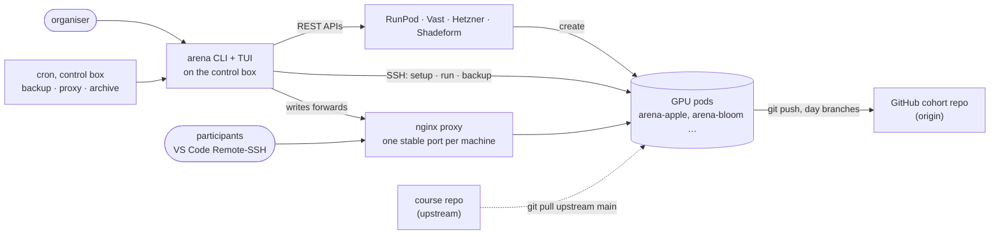
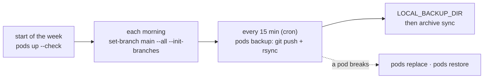
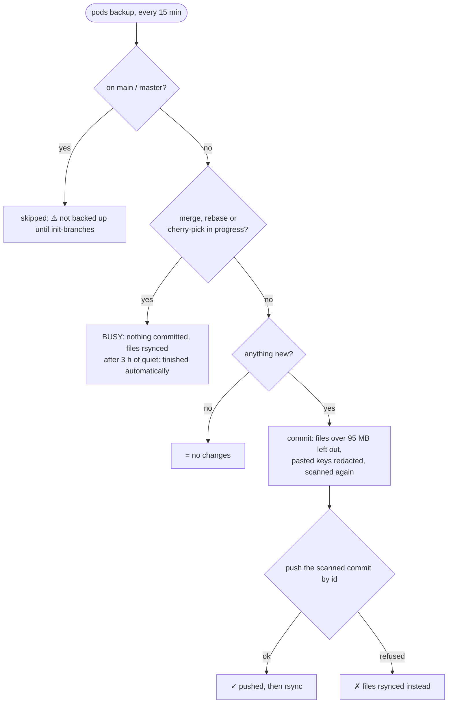

<div align="center">

[](https://arena.education/)

# arena-infra-rs

**One CLI and a live dashboard for running an [ARENA](https://arena.education/) cohort's GPU pods**

[](https://github.com/nickypro/arena-infra-rs/actions/workflows/ci.yml)
[](.github/workflows/ci.yml)
[](docs/REFERENCE.md#providers)
[](LICENSE)

</div>

A streamlined Rust rewrite of [`arena-infra`](https://github.com/nickypro/arena-infra) — the
control plane for ARENA's GPU pods. Goals: multi-provider machine spin-up, a tidy commit/backup
flow, a performance/GPU/progress dashboard, and robust port forwarding, behind both a CLI and an
interactive TUI. `arena` creates the cohort's pods on RunPod, Vast.ai, Hetzner or Shadeform, sets
each one up, gives every machine a stable SSH address, and backs the participants' work up every
15 minutes.



## TL;DR for organisers

| Command | What it does |
| --- | --- |
| `arena pods list` | Every pod: GPU, $/h, endpoint, maintenance; a fleet cost and balance footer |
| `arena pods up -n 20 --gpu A4000,3090 --check` | Create pods up to 20, then set each up and deep-check it, one pipeline per pod |
| `arena pods create apple bloom` | Create just these pods (no setup) |
| `arena pods setup` | (Re)provision pods: deploy key, repo, tokens, VS Code warm-up, API keys |
| `arena pods set-branch main --all --init-branches` | Morning: back each pod up, switch it to `main`, create today's branch |
| `arena pods init-branches` | Create and push each pod's `wNdM` day branch |
| `arena pods backup` | Git-push each pod's branch, then rsync its home (what cron runs) |
| `arena pods pull` | Rsync each pod's home into `LOCAL_BACKUP_DIR` (the file backup alone) |
| `arena pods test --deep` | Is this pod usable? A pass / warn / fail row per pod (read-only) |
| `arena tui` | The live dashboard |
| `arena proxy apply` | Write the proxy forwards and reload nginx |
| `arena ssh-config --proxy` | Print the participants' `~/.ssh/config` |
| `arena cron install --pull --proxy` | Backups every 15 min (git + rsync), proxy re-sync every 5 |
| `arena pods restore apple` | Push a backup back onto one pod (never deletes) |
| `arena pods replace apple` | Move a pod to a fresh host, keeping its name and files |
| `arena pods run -t apple 'nvidia-smi'` | Run a command on pods (all of them without `-t`) |
| `arena balance` | Money left on each prepaid account, and how long it lasts |
| `arena config check` | Which config keys are set, missing or unusable (never prints values) |
| `arena teardown --check` | End of the program: what's still billing, with the command that cleans it up |

Every mutating command shows what it will do and asks first; `--dry-run` previews it.
Subcommands take any unambiguous prefix (`arena po l` = `arena pods list`). Pods are named
`apple`, `arena-apple`, `apple..mayor`, `--all`, … — see
[targeting](docs/REFERENCE.md#targeting--concurrency).

## Getting started

### 1. Build

```bash
git clone https://github.com/nickypro/arena-infra-rs.git && cd arena-infra-rs
cargo build --release      # target/release/arena and target/release/arena-tui
```

Keep the two binaries side by side on your `PATH`: `arena tui` starts the `arena-tui` next to it.

### 2. Get the keys

- a **provider API key**: RunPod (Vast, Hetzner and Shadeform are optional);
- a **shared SSH key** for the cohort — the pods authorize it, the participants get it:
  `ssh-keygen -t ed25519 -N "" -C "arena-cohort" -f ~/.ssh/arena_cohort_key`
- a **deploy key** with write access to the cohort's GitHub repo, which the pods push to.

<details>
<summary>Why one key shared by every participant?</summary>

Pods hold no sensitive data and the participants are trusted, so being able to move people
between machines without per-person setup is worth more than per-person keys — the same choice
the original [`arena-infra`](https://github.com/nickypro/arena-infra) made.

</details>

### 3. Write `config.env`

```bash
cp config.env.example config.env
arena --config ./config.env config set RUNPOD_API_KEY      # prompts; never echoes the value
arena --config ./config.env config check                   # a ✓ / ✗ row per key
```

| Key | What it is |
| --- | --- |
| `RUNPOD_API_KEY` | The provider key (`VAST_API_KEY`, `HETZNER_API_KEY`, `SHADEFORM_API_KEY` for the others) |
| `MACHINE_NAME_PREFIX`, `MACHINE_NAME_LIST` | Pod names: `arena-apple`, `arena-bloom`, …; a name's place in the list is its proxy port |
| `SHARED_SSH_KEY_PATH` | The shared SSH key from step 2 |
| `GPU_TYPE`, `NUM_GPUS`, `CLOUD_TYPE`, `IMAGE`, `DISK_GB` | What `create`/`up` make when no flag says otherwise |
| `ARENA_REPO_OWNER`, `ARENA_REPO_NAME` | The cohort repo the pods push to |
| `GIT_SSH_KEY_LOCAL`, `GIT_SSH_KEY_REMOTE` | The deploy key here, and where it goes on each pod |
| `ARENA_START_DATE` | The program's first Monday: day branches are named `w<week>d<day>` from it |
| `LOCAL_BACKUP_DIR` | Where the rsync backups go (make it absolute) |
| `SSH_PROXY_HOST`, `SSH_PROXY_STARTING_PORT` | The proxy's public host, and the first machine's port |

Every key, with its default: [`config.env.example`](config.env.example) and the
[config key table](FEATURE_MAP.md#config-keys-added-in-phases-04). The built-in `--config`
default is a path on ARENA's own control box, so pass `--config` (an `alias arena='arena
--config ~/arena/config.env'` saves typing). A key in the file can be overridden for one run by
an environment variable of the same name ([details](docs/REFERENCE.md#overriding-config-without-editing-it)).

### 4. The first pods

```bash
arena pods up -n 4 --dry-run     # preview: the names and the pipeline; nothing is created
arena pods up -n 4 --check       # [arena-apple] READY after 4m10s — … as each pod finishes
arena ssh-config --proxy         # the ~/.ssh/config to hand to the participants
```

`up` syncs the proxy itself. Participants get the shared key and that `~/.ssh/config`, and
connect with VS Code's `Remote-SSH: Connect to Host…`.

### 5. Turn the backups on

```bash
arena cron install --pull --proxy    # shows the crontab diff, asks first
arena cron show
```

Add `--archive` for the [backup archive](docs/BACKUPS.md#backup-archive-arena-archive) (a second
copy participants can read; `arena archive up` first), `--snapshot DIR` for the
[public fleet page](docs/REFERENCE.md#publishing-the-fleet-page).

## A cohort day



1. **Morning check.** `arena pods list` (cost, balance, maintenance windows), then
   `arena pods test --deep`: a `FAIL` on the host means `arena pods replace <pod>`.
2. **The day's branches.** `arena pods set-branch main --all --init-branches` backs each pod up,
   switches it to `main` and creates today's `autocommit-<prefix>-w1d2-<machine>` branch. Until
   then a pod on `main` isn't backed up, and the run says so.
3. **Backups run themselves.** Every 15 minutes cron runs `pods backup`; its log is
   `~/.local/state/arena-cron/backup.log`. Each pod gets one line:

   | Line | Meaning |
   | --- | --- |
   | `[3/20] ✓ arena-apple -> autocommit-arena-w1d2-apple` | Committed and pushed |
   | `[4/20] = arena-bloom (no changes, on autocommit-…)` | Nothing new since the last push |
   | `✗ <pod>: a merge is in progress on <branch> — …` | Not pushed: the line says why and what to do. A refused push or a half-done merge gets the pod's files rsynced instead |
   | `⊘ skipped N non-cohort pods (…)` | Left out on purpose (staff boxes, other prefixes), not a failure |
   | `⊘ <pod>: not finished automatically — notes.py changed 40 min ago — …` | A half-done merge waits for 3 h of quiet, then finishes by itself |
   | `⚠ 12 cohort pods on main: not backed up until …` | Pods on `main`: run `arena pods init-branches` |

4. **Getting a pod back.**

   | Something went wrong | Do this |
   | --- | --- |
   | The host is broken (deep check FAIL, no GPU) | `arena pods replace <pod>` — same name, port and files on a fresh host |
   | Files lost, or the pod was wiped | `arena pods restore <pod>` — newest snapshot; `--from big` for every file, `--from w1d3` for a day |
   | The pod was stopped | `arena pods start <pod>` — set up and proxied again (RunPod/Vast: a fresh image; only a `/workspace` volume survived) |
   | A participant wants an old file | `sftp archive-<prefix>`, once `arena archive access on` |

## The dashboard

`arena tui` — every pod with its GPU load, branch, last backup, health and proxy port, refreshed
every few seconds. Every action on a pod asks first; restart, stop and terminate need the pod's
name typed back.

```text
┌──────────────────────────────────────────────────────────────────────────────────────────────────────────────────────┐
│arena-infra-rs dashboard · provider: runpod · ./config.env                                                            │
└──────────────────────────────────────────────────────────────────────────────────────────────────────────────────────┘
 5 pods · 6 GPUs · mean util 54% · fleet: $1.17/h across 5 billing pod(s) ≈ $28.08/day  ·  balance: runpod $214.30 ≈7.6d
┌Pods──────────────────────────────────────────────────────────────────────────────────────────────────────────────────┐
│    P NAME       STAT M SET  GPU              GPU%  MEM       TEMP DISK      $/H     HEALTH   PROXY  BRANCH SAVED     │
│▶   R apple      run    ✓✓✓✓ 1×RTX A4000 16G  87%   10/16G    71C  40/98G    $0.17   pass 12m :9500  w1d2   4m        │
│    R bloom      run    ✓✓✓✓ 1×RTX A4000 16G  0%    1/16G     34C  40/98G    $0.17   pass 50m :9501  w1d2   13m       │
│    V cedar      run    ✓✓✓✓ 1×RTX 3090 24G   0%    0/24G     30C  40/98G    $0.22   fail 2h  :9502  w1d2   3h        │
│    R delta      run  L ✓✓✓✓ 1×RTX A4000 16G  42%   7/16G     63C  40/98G    $0.17   pass 15m :9503  main   8m        │
│    R ember      run    ✓✓✓✓ 2×RTX 3090 24G   98%   45/48G    78C  40/98G    $0.44   pass 10m :9504  w1d2   2m        │
│                                                                                                                      │
└──────────────────────────────────────────────────────────────────────────────────────────────────────────────────────┘
 · updated 0s ago · every 5s · [q] quit  [enter] detail  [c] ssh  [space] mark  [/] select  [x] unmark all  [a] act  [A]
```

<sup>A made-up fleet, drawn by the dashboard's own renderer from test fixtures.</sup>
`a` acts on the selected pod, `A` on the fleet, `d` deep-checks, `n` adds pods.
[All the keys and columns](docs/REFERENCE.md#the-dashboard-arena-tui).

## The proxy


A provider moves a pod's SSH endpoint whenever it restarts, so each machine gets a **stable
public port** on the proxy host (`proxy.example.com:7000`, `:7001`, …), anchored to its place in
`MACHINE_NAME_LIST`. nginx's `stream` module forwards it to wherever the pod is now. Participants'
`~/.ssh/config` never changes; `arena` rewrites only the forwards, after every create, rename or
terminate, and cron catches the rest every 5 minutes.
[How the forwards are planned](docs/REFERENCE.md#proxy-and-ssh-config).

## Backups



With `cron install --pull`, two copies every 15 minutes: **git** (each pod's day branch on
GitHub) and **rsync** (each pod's home in `LOCAL_BACKUP_DIR`: a hard-linked snapshot per day
plus an all-files `big/` mirror). The optional archive VM keeps a second copy of
`LOCAL_BACKUP_DIR` that outlives the pods.
[Everything about backups](docs/BACKUPS.md).

## Safety

`arena` runs against a live cohort, so it is careful with the participants' work:

- **Asks first.** Every mutating command shows what it will do; with no terminal (cron, pipes) it
  refuses unless `--yes`. `--dry-run` previews any of them. [Safety model](docs/REFERENCE.md#safety-model-this-is-developed-against-live-production)
- **Redacts pasted keys**: known key formats are committed as `REDACTED-…` (the file on disk is
  untouched) and what goes out is scanned again right before the push; files over 95 MB stay out
  of git. [Pasted keys](docs/BACKUPS.md#pasted-keys-are-redacted)
- **Never commits a half-done merge**: the pod is copied instead, and finished only after 3 h of
  quiet, keeping the state before. [BUSY](docs/BACKUPS.md#busy-an-operation-in-progress)
- **Never wipes work unasked**: `restart`/`stop` refuse a pod whose repo isn't on a volume without
  `--wipe-ok`; `set-branch --hard` saves what it discards on the pod first.
  [The wipe gate](docs/REFERENCE.md#pods-restart-and-pods-stop-the-wipe-gate) ·
  [`--hard`](docs/BACKUPS.md#what---hard-saves-before-it-resets)
- **Restores never delete**: `restore` never deletes and never reverts newer work; archive pushes
  are additive, and nothing there is deleted automatically. [Restore](docs/BACKUPS.md#pods-restore)
- **Never reaps without a backup**: the auto-reaper is opt-in, and terminates only after a
  verified backup. [The reaper](docs/BACKUPS.md#pods-reap)
- **Locks**: `arena pods lock --all` makes RunPod refuse stop/restart/terminate from any client.
  [Locks](docs/REFERENCE.md#pods-lock--pods-unlock)

## Development

```bash
cargo build --release
cargo test --release     # everything offline: pure planners, fake providers, FakeRemote, fixtures
cargo clippy --all-targets --locked -- -D warnings
```

CI runs the same gate on every push. The opt-in [live smoke test](docs/REFERENCE.md#the-live-smoke-test)
creates, checks and terminates one cheap pod — run it before each cohort.

<details>
<summary>AI review before merging</summary>

`scripts/ai-review` gets a second-opinion review of a change from codex and/or Claude Code, from
git objects only, with key-like strings masked:

```bash
scripts/ai-review                        # origin/master..HEAD, codex + claude
scripts/ai-review --pr 4                 # gh pr diff/view
scripts/ai-review --dry-run              # only write prompt.txt: nothing is sent
```

What it sends, where the reviews go, and what it costs:
[AI review before merging](docs/REFERENCE.md#ai-review-before-merging).

</details>

<details>
<summary>Release process</summary>

Work on `dev/phase0` → `cargo test --release` + the live smoke in the sandbox → PR to master,
**running `scripts/ai-review` (or `--pr N`) before merging it** → `cargo install` to prod only
between cohort sessions, keeping the previous binary as `arena.prev` for an instant rollback.

</details>

<details>
<summary>Layout</summary>

```
crates/
  core/   library: config, provider trait + impls, Remote, planners/judges (see ARCHITECTURE.md)
  cli/    `arena` binary (clap); tests/live_smoke.rs = the opt-in live smoke test
  tui/    `arena-tui` binary (ratatui)
scripts/
  ai-review   a second-opinion review by codex/claude (see docs/REFERENCE.md "AI review before merging")
web/
  fleet.html  the public fleet page (reads fleet.json next to it)
docs/     REFERENCE.md (every command), BACKUPS.md (backups and the participants' work),
          RunPod API notes, known issues
```

</details>

## More docs

| Doc | What's in it |
| --- | --- |
| [docs/REFERENCE.md](docs/REFERENCE.md) | Every command, flag and config key, by command group; providers; the dashboard; testing |
| [docs/BACKUPS.md](docs/BACKUPS.md) | Backups in depth: git and redaction, BUSY and auto-resolve, set-branch, pulls, restore, cron, the reaper, the archive |
| [ARCHITECTURE.md](ARCHITECTURE.md) | Crates, core modules, a request's flow, the safety model, extending |
| [FEATURE_MAP.md](FEATURE_MAP.md) | The legacy scripts → `arena` commands, config keys, provider status |
| [docs/runpod-api.md](docs/runpod-api.md) | The RunPod API as `arena` uses it, and its gotchas |
| [docs/TODO.md](docs/TODO.md) | Known issues |
