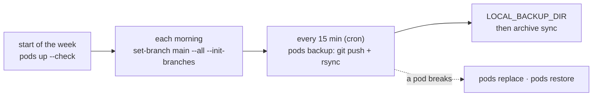

<div align="center">

[](https://arena.education/)

# arena-infra-rs

**One CLI and a live dashboard for running an [ARENA](https://arena.education/) cohort's GPU pods**

[](https://github.com/nickypro/arena-infra-rs/actions/workflows/ci.yml)
[](.github/workflows/ci.yml)
[](docs/REFERENCE.md#providers)
[](LICENSE)

</div>

A streamlined Rust rewrite of [`arena-infra`](https://github.com/nickypro/arena-infra) — the
control plane for ARENA's GPU pods. Goals: multi-provider machine spin-up, a tidy commit/backup
flow, a performance/GPU/progress dashboard, and robust port forwarding, behind both a CLI and an
interactive TUI. `arena` creates the cohort's pods on RunPod, Vast.ai, Hetzner or Shadeform, sets
each one up, gives every machine a stable SSH address, and backs the participants' work up every
15 minutes.


## TL;DR

### Just want some GPU pods?

Pods up, SSH in, pods down: no proxy, no backups, no day branches.

```bash
git clone https://github.com/nickypro/arena-infra-rs.git && cd arena-infra-rs
cargo build --release                              # target/release/arena
alias arena="$PWD/target/release/arena --config $PWD/config.env"
ssh-keygen -t ed25519 -N "" -f ~/.ssh/arena_key    # the key your pods will let in
cp config.env.example config.env                   # then set the four keys below
arena config set RUNPOD_API_KEY                    # prompts; never echoes the value
```

| Key in `config.env` | Set it to |
| --- | --- |
| `RUNPOD_API_KEY` | Your RunPod API key (the `config set` above) |
| `SHARED_SSH_KEY_PATH` | `~/.ssh/arena_key`: each new pod lets it in; `ssh-config` makes it the `IdentityFile` |
| `MACHINE_NAME_PREFIX` | e.g. `arena`, so the pods are `arena-apple`, `arena-bloom`, … |
| `MACHINE_NAME_LIST` | The names, used in order: `MACHINE_NAME_LIST=(apple bloom cedar)` |

The example sets `SSH_PROXY_HOST`: comment it out (no proxy). Its GPU, image and disk are fine as
they are.

```bash
arena pods up -n 2 --no-setup              # create 2 pods; wait until each answers SSH
arena ssh-config --install                 # once: ~/.ssh/arena.conf, Included by ~/.ssh/config
arena config set SSH_CONFIG_FILE '~/.ssh/arena.conf'   # once: keep it current
ssh arena-apple                            # or VS Code: Remote-SSH: Connect to Host…
arena pods list                            # GPU, $/h, endpoint; the fleet's cost and balance
arena pods terminate --all                 # EVERY pod on the account, prefix or not; asks first
```

`--no-setup` skips provisioning, the one step that needs a cohort repo and its deploy key
(without the flag, `up` stops before creating anything while they're unset): each pod is the
image as it boots. A pod's endpoint moves when it restarts: with `SSH_CONFIG_FILE` set, every
pod change, `pods list` and the dashboard rewrite `~/.ssh/arena.conf` when one moved, so
`ssh arena-apple` keeps working. `ssh-config --install` shows what it changes and asks first.

### Running a cohort, or anything for an org?

Add these on top. [Getting started](#getting-started) walks through them in order:

| Add | What you get | Config keys |
| --- | --- | --- |
| **[The proxy](#the-proxy)** (recommended) | One stable address per machine: participants' `~/.ssh/config` never changes | `SSH_PROXY_HOST`, `SSH_PROXY_STARTING_PORT` |
| **Setup** (drop `--no-setup`) | Each pod gets the deploy key, the cohort repo, tokens and the VS Code warm-up | `ARENA_REPO_OWNER`, `ARENA_REPO_NAME`, `GIT_SSH_KEY_LOCAL` |
| **Day branches** | Each pod's work on its own `autocommit-<prefix>-w1d2-<machine>` branch | `ARENA_START_DATE` |
| **Backups on cron** | A git push and an rsync copy of every pod, every 15 minutes | `LOCAL_BACKUP_DIR` |
| **Morning health check on cron** | `pods test --deep` on every cohort pod each morning (`arena cron install --health 07:20`): a pass / warn / fail row per pod, and the dashboard's HLTH column | |

<details>
<summary>The main organiser commands at a glance</summary>

| Command | What it does |
| --- | --- |
| `arena pods list` | Every pod: GPU, $/h, endpoint, maintenance; a fleet cost and balance footer |
| `arena offers` | What `pods up` would try on each provider (RunPod, Vast, Hetzner) and its $/h; `arena offers runpod` (or `vast`, `hetzner`, `all`): everything on sale there, B300 and MIG slices included |
| `arena pods up -n 20 --gpu A4000,3090 --check` | Create pods up to 20, then set each up and deep-check it, one pipeline per pod |
| `arena pods create apple bloom` | Create just these pods (no setup) |
| `arena pods setup` | (Re)provision pods: deploy key, repo, tokens, VS Code warm-up, API keys |
| `arena pods set-branch main --all --init-branches` | Morning: back each pod up, switch it to `main`, create today's branch |
| `arena pods init-branches` | Create and push each pod's `wNdM` day branch |
| `arena pods backup` | Git-push each pod's branch, then rsync its home (what cron runs) |
| `arena pods pull` | Rsync each pod's home into `LOCAL_BACKUP_DIR` (the file backup alone) |
| `arena pods test --deep` | Is this pod usable? A pass / warn / fail row per pod (read-only) |
| `arena pods ask apple "why is it slow?"` | Ask claude or codex about pods' current state (read-only; keys masked) |
| `arena tui` | The live dashboard |
| `arena proxy apply` | Write the proxy forwards and reload nginx |
| `arena ssh-config --proxy` | Print the participants' `~/.ssh/config` |
| `arena ssh-config --admin --install` | On the proxy box: staff reach every machine with the admin key |
| `arena cron install --pull --proxy` | Backups every 15 min (git + rsync), proxy re-sync every 5 |
| `arena cron install --health 07:20` | A deep check of every cohort pod each morning, in this box's time zone |
| `arena pods restore apple` | Push a backup back onto one pod (never deletes) |
| `arena pods replace apple` | Move a pod to a fresh host, keeping its name and files |
| `arena pods replace apple --server-type cx43` | Hetzner: move a box to a bigger type (`pods spare up` grabs room ahead; `pods copy-home` moves a person to another machine) |
| `arena pods run -t apple 'nvidia-smi'` | Run a command on pods (all of them without `-t`) |
| `arena balance` | Money left on each prepaid account, and how long it lasts |
| `arena keys limit apple +5` | Raise a participant's AI (OpenRouter) cap by $5, in place (`10` sets it; `--all`); `keys pause`/`resume` stop and restart a key |
| `arena spend` | What each machine cost and who it was for (`--owner` on `pods up`) |
| `arena config check` | Which config keys are set, missing or unusable (never prints values) |
| `arena teardown --check` | End of the program: what's still billing, with the command that cleans it up |
| `arena image build` | Hetzner only: bake a pre-built image, so a new VM's setup takes about a minute, not ten (`HETZNER_IMAGE=arena`) |
| `arena update` | Install the newest release, after showing what changed (`--check` only says) |

</details>

Every mutating command shows what it will do and asks first; `--dry-run` previews it.
`arena --help` and `arena pods --help` list the commands in groups. Subcommands take any
unambiguous prefix (`arena po li` = `arena pods list`). Pods are named
`apple`, `arena-apple`, `apple..mayor`, `--all`, … — see
[targeting](docs/REFERENCE.md#targeting--concurrency).

## Getting started

The cohort route, in order. Only want pods? [The TL;DR](#just-want-some-gpu-pods) is all of it.

### 1. Build

```bash
git clone https://github.com/nickypro/arena-infra-rs.git && cd arena-infra-rs
cargo build --release      # target/release/arena and target/release/arena-tui
```

Keep the two binaries side by side on your `PATH`: `arena tui` starts the `arena-tui` next to it.

Or skip the build on Linux (x86_64 or arm64): download `arena-<platform>` and
`arena-tui-<platform>` from the [latest release](https://github.com/nickypro/arena-infra-rs/releases/latest),
check their build provenance (each must print the same run):

```bash
gh attestation verify <file> --repo nickypro/arena-infra-rs --deny-self-hosted-runners \
  --cert-identity https://github.com/nickypro/arena-infra-rs/.github/workflows/release.yml@refs/heads/master \
  --source-ref refs/heads/master --format json --jq '.[0].verificationResult.signature.certificate.runInvocationURI'
```

and make them executable, named `arena` and `arena-tui`.

Later, `arena update` shows what changed since your build (anything you must do first) and
installs the newest release in place, keeping `arena.prev`, once it has verified that this
repository's release workflow built it. `arena update --check` only says.

### 2. Get the keys

- a **provider API key**: RunPod (Vast, Hetzner and Shadeform are optional);
- a **shared SSH key** for the cohort — the pods authorize it, the participants get it:
  `ssh-keygen -t ed25519 -N "" -C "arena-cohort" -f ~/.ssh/arena_cohort_key`
- a **deploy key** with write access to the cohort's GitHub repo, which the pods push to (setup
  and backups need it);
- optionally, an **admin key** that only the proxy box holds:
  `ssh-keygen -t ed25519 -N "" -C "arena-admin" -f /root/.ssh/arena_admin_key`.

Every machine — the cohort's pods and the `@` staff boxes — lets in all three. Who holds each
private half:

| Key (config) | Role | Its private half is on |
| --- | --- | --- |
| `SHARED_SSH_KEY_PATH` | participants | every participant's laptop, and the box running arena |
| `GIT_SSH_KEY_LOCAL` | deploy (git push; pods reach each other) | every pod, and the box running arena |
| `ADMIN_SSH_KEY_PATH` | admin (staff, and arena itself first) | the proxy box only — staff log in there, then reach any machine (`arena ssh-config --admin --install`) |

<details>
<summary>Why one key shared by every participant?</summary>

Pods hold no sensitive data and the participants are trusted, so being able to move people
between machines without per-person setup is worth more than per-person keys — the same choice
the original [`arena-infra`](https://github.com/nickypro/arena-infra) made.

</details>

### 3. Write `config.env`

```bash
cp config.env.example config.env
arena --config ./config.env config set RUNPOD_API_KEY      # prompts; never echoes the value
arena --config ./config.env config check                   # a ✓ / ✗ row per key
```

| Key | What it is |
| --- | --- |
| `RUNPOD_API_KEY` | The provider key (`VAST_API_KEY`, `HETZNER_API_KEY`, `SHADEFORM_API_KEY` for the others) |
| `MACHINE_NAME_PREFIX`, `MACHINE_NAME_LIST` | Pod names: `arena-apple`, `arena-bloom`, …; a name's place in the list is its proxy port |
| `SHARED_SSH_KEY_PATH` | The shared SSH key from step 2 |
| `GPU_TYPE`, `NUM_GPUS`, `CLOUD_TYPE`, `IMAGE`, `DISK_GB` | What `create`/`up` make when no flag says otherwise |
| `ARENA_REPO_OWNER`, `ARENA_REPO_NAME` | The cohort repo the pods push to |
| `GIT_SSH_KEY_LOCAL`, `GIT_SSH_KEY_REMOTE` | The deploy key here, and where it goes on each pod |
| `ADMIN_SSH_KEY_PATH` | Optional: the admin key from step 2, on the proxy box |
| `ARENA_START_DATE` | The program's first Monday: day branches are named `w<week>d<day>` from it |
| `LOCAL_BACKUP_DIR` | Where the rsync backups go (make it absolute) |
| `SSH_PROXY_HOST`, `SSH_PROXY_STARTING_PORT` | The proxy's public host, and the first machine's port ([step 4](#4-set-up-the-proxy-recommended-for-a-cohort)) |

Every key, with its default: [`config.env.example`](config.env.example) and the
[config key table](FEATURE_MAP.md#config-keys-added-in-phases-04). The built-in `--config`
default is a path on ARENA's own control box, so pass `--config` (an `alias arena='arena
--config ~/arena/config.env'` saves typing). A key in the file can be overridden for one run by
an environment variable of the same name ([details](docs/REFERENCE.md#overriding-config-without-editing-it)).

### 4. Set up the proxy (recommended for a cohort)

More than one person on the pods? **Set up the proxy now**, before the first pods, so `up` gives
each pod its stable address as it comes up: [the six steps](#setting-up-the-proxy). On your own,
skip it.

### 5. The first pods

```bash
arena pods up -n 4 --dry-run     # preview: the names and the pipeline; nothing is created
arena pods up -n 4 --check       # [arena-apple] READY after 4m10s — … as each pod finishes
arena ssh-config --proxy         # the ~/.ssh/config to hand to the participants
```

`up` syncs the proxy itself. Participants get the shared key and that `~/.ssh/config`, and
connect with VS Code's `Remote-SSH: Connect to Host…`. No proxy? Hand out
`arena ssh-config --out …` instead, and again after every restart.

### 6. Turn the backups on

```bash
arena cron install --pull --proxy    # shows the crontab diff, asks first (no proxy: drop --proxy)
arena cron show
```

Add `--archive` for the [backup archive](docs/BACKUPS.md#backup-archive-arena-archive) (a second
copy participants can read; `arena archive up` first), `--snapshot DIR` for the
[public fleet page](docs/REFERENCE.md#publishing-the-fleet-page), `--health 07:20` for a
[morning deep check](docs/BACKUPS.md#cron-the-lines-that-run-it-all) of every cohort pod.

## A cohort day



1. **Morning check.** `arena pods list` (cost, balance, maintenance windows), then
   `arena pods test --deep` (or read what `cron install --health 07:20` found in
   `~/.local/state/arena-cron/health.log`): a `FAIL` on the host means `arena pods replace <pod>`.
2. **The day's branches.** `arena pods set-branch main --all --init-branches` backs each pod up,
   switches it to `main` and creates today's `autocommit-<prefix>-w1d2-<machine>` branch. Until
   then a pod on `main` isn't backed up, and the run says so.
3. **Backups run themselves.** Every 15 minutes cron runs `pods backup`; its log is
   `~/.local/state/arena-cron/backup.log`, and `arena backups` (the dashboard's `b`) says
   whether each run is on time and which pods are failing. Each pod gets one line in the log:

   | Line | Meaning |
   | --- | --- |
   | `[3/20] ✓ arena-apple -> autocommit-arena-w1d2-apple` | Committed and pushed |
   | `[4/20] = arena-bloom (no changes, on autocommit-…)` | Nothing new since the last push |
   | `✗ <pod>: a merge is in progress on <branch> — …` | Not pushed: the line says why and what to do. A refused push or a half-done merge gets the pod's files rsynced instead |
   | `⊘ skipped N non-cohort pods (…)` | Left out on purpose (staff boxes, other prefixes), not a failure |
   | `⊘ <pod>: not finished automatically — notes.py changed 40 min ago — …` | A half-done merge waits for 3 h of quiet, then finishes by itself |
   | `⚠ 12 cohort pods on main: not backed up until …` | Pods on `main`: run `arena pods init-branches` |

4. **Getting a pod back.**

   | Something went wrong | Do this |
   | --- | --- |
   | The host is broken (deep check FAIL, no GPU) | `arena pods replace <pod>` — same name, port and files on a fresh host |
   | Files lost, or the pod was wiped | `arena pods restore <pod>` — newest snapshot; `--from big` for every file, `--from w1d3` for a day |
   | The pod was stopped | `arena pods start <pod>` — set up and proxied again (RunPod/Vast: a fresh image; only a `/workspace` volume survived) |
   | A participant wants an old file | `sftp archive-<prefix>`, once `arena archive access on` |

## The dashboard

`arena tui` — every pod with its GPU load, branch, last backup, health and proxy port, refreshed
every few seconds. Every action on a pod asks first; restart, stop and terminate need the pod's
name typed back.

```text
 5 pods, 5 GPUs 45% │ 4 RunPod $214.30 ≈7.6d · $1.40/h │ 1 Vast $0.22/h                                    ./config.env
┌Pods──────────────────────────────────────────────────────────────────────────────────────────────────────────────────┐
│    P NAME             STAT M SET  GPU              GPU% MEM       TEMP DISK      $/H    HLTH  PROXY RTT   BRANCH 💾  │
│▶   R apple            run    ✓✓✓✓ 1×RTX A4000 16G  87%  10/16G    71C  40/98G    $0.17  ✓12m  9500  -     w1d2   4m  │
│    R bloom            run    ✓✓✓✓ 1×RTX A4000 16G  0%   1/16G     34C  40/98G    $0.17  ✓50m  9501  -     w1d2   13m │
│    V cedar            run    ✓✓✓✓ 1×RTX 3090 24G   0%   0/24G     30C  40/98G    $0.22  ✗2h   9502! -     w1d2   3h  │
│    R delta            run  L ✓✓✓✓ 1×RTX A4000 16G  42%  7/16G     63C  40/98G    $0.17  ✓15m  9503  -     main   8m  │
│    R ember            run    ✓✓✓✓ 1×B300 MIG 34G   98%  -         78C  40/98G    $0.89  ✓10m  9504  -     w1d2   2m  │
│                                                                                                                      │
└──────────────────────────────────────────────────────────────────────────────────────────────────────────────────────┘
[i] info · ok · API 6/min · ↻ 0s ago · every 5s  [q] quit  [enter] detail  [a/A] act/all  [space/x] mark/clear  [d/D] de
```

<sup>A made-up fleet, drawn by the dashboard's own renderer from test fixtures.</sup>
`a` acts on the selected pod (`a a` raises its AI key's cap), `A` on the fleet, `d`/`D` deep-check it/all, `n` adds pods, and `?` asks
claude or codex about the pod ([`pods ask`](docs/REFERENCE.md#pods-ask)). The top line groups the
fleet by provider, each with its balance, runway and burn, and a `⚠` where something needs you. `i`
(or a click on `[i] info` or the top line) opens the info panel: everything the two bars leave out,
every key, and what the glyphs mean.
[All the keys and columns](docs/REFERENCE.md#the-dashboard-arena-tui).

## The proxy

> **Running a cohort, or anything with more than one person? Set up the proxy.** On your own,
> you can skip it.


A provider moves a pod's SSH endpoint whenever it restarts, and without a proxy everyone's
`~/.ssh/config` goes stale with it. With one, each machine gets a **stable public port** on the
proxy host (`proxy.example.com:7000`, `:7001`, …), anchored to its place in `MACHINE_NAME_LIST`,
and nginx's `stream` module forwards it to wherever the pod is now. Participants' `~/.ssh/config`
never changes; `arena` rewrites only the forwards, after every create, rename or terminate, and
cron catches the rest every 5 minutes.

### Setting up the proxy

1. **A proxy host**: an always-on server with a public address. Simplest is to run `arena` and its
   cron on it, which is the default. For a proxy on another box, set `PROXY_LOCAL=false` (step 3):
   arena then installs the file there over SSH (port 22), offering the shared key and whatever
   your `~/.ssh/config` gives that host. Let your own key in there, not the participants' shared one.
2. **nginx with the `stream` module** (Debian/Ubuntu: `libnginx-mod-stream`), with the TCP ports
   open: `SSH_PROXY_STARTING_PORT` onwards, one per name in `MACHINE_NAME_LIST`. arena writes a
   file of bare `server` blocks, so include it from nginx's top-level `stream {}` block:

   ```nginx
   # /etc/nginx/nginx.conf, at the top level (not inside http { … })
   stream { include /etc/nginx/streams-enabled/*.conf; }
   ```

   Then `sudo mkdir -p /etc/nginx/streams-enabled && sudo nginx -t`
   (`unknown directive "stream"` = the module is missing). arena must be able to write there, as
   the user it runs as (or as `SSH_PROXY_USER` on a remote proxy).
3. **The keys** in `config.env`:

   | Key | What it is | Unset |
   | --- | --- | --- |
   | `SSH_PROXY_HOST` | The public name or IP the participants connect to | no proxy |
   | `SSH_PROXY_STARTING_PORT` | The first name's port; the next name gets +1, and so on | `7000` |
   | `SSH_PROXY_NGINX_CONFIG_PATH` | The file arena writes, e.g. `/etc/nginx/streams-enabled/arena.conf` | `~/proxy.conf` |
   | `SSH_PROXY_RELOAD_CMD` | Run after each write: `sudo nginx -t && sudo nginx -s reload` when not root; empty = write the file, never reload | `nginx -t && nginx -s reload` |
   | `PROXY_LOCAL`, `SSH_PROXY_USER` | `false` = the proxy is another box, reached over SSH as this user | this box, `root` |

4. **Write the forwards**: `arena proxy plan` previews them (read-only); `arena proxy apply`
   writes the file and reloads nginx. From then on `create`, `up`, `terminate`, `rename` and
   `replace` sync it themselves.
5. **Hand out the config, once**: `arena ssh-config --proxy --out arena.conf` has a `Host` for
   every name in `MACHINE_NAME_LIST`, running or not. Participants save it as
   `~/.ssh/arena.conf` beside the shared key and make `Include ~/.ssh/arena.conf` the first line
   of their `~/.ssh/config`. Its `IdentityFile` is `SHARED_SSH_KEY_PATH` as written, so a
   `~/.ssh/…` path works on their machines too.
6. **Keep it in sync**: `arena cron install --proxy` runs `proxy apply` every 5 minutes, which
   catches changes made outside arena.

**Without a proxy**, `arena ssh-config --out ~/.ssh/arena.conf` writes each pod's current
endpoint. Run it again after any create, restart or replace; everyone who connects needs the
new file. [How the forwards are planned](docs/REFERENCE.md#proxy-and-ssh-config).

## Backups


With `cron install --pull`, two copies every 15 minutes: **git** (each pod's day branch on
GitHub) and **rsync** (each pod's home in `LOCAL_BACKUP_DIR`: a hard-linked snapshot per day
plus an all-files `big/` mirror). The optional archive VM keeps a second copy of
`LOCAL_BACKUP_DIR` that outlives the pods. `arena backups` (or `b` in the dashboard) shows
which of these are set up, when each last ran and how every pod is doing:
[what gets backed up, where and when](docs/BACKUPS.md#what-gets-backed-up-where-and-when).
[Everything about backups](docs/BACKUPS.md).

## Tracking spend

Who cost what, compute and AI, per person, for the organisers — on the fleet you already run, a
project week included: give each machine an owner when you make it (or afterwards), then ask.

```bash
arena pods up apple bloom --owner alice     # every new instance records its owner
arena spend                                  # one row per owner, then "(no owner)", then totals
arena spend --by machine --csv > spend.csv   # one row per instance, for a spreadsheet
arena spend assign cedar bob                 # a machine that already exists, or a forgotten --owner
arena spend --since 2026-11-02               # only from that day (UTC)
```

```text
OWNER       MACHINES      HOURS  COMPUTE         AI     TOTAL
alice       apple, bloom   41.0  $9.84 + €0.43   $3.10  $12.94 + €0.43
bob         cedar           6.5  ~$1.56          $0.40  ~$1.96
(no owner)  delta           2.0  $0.48           $0.00  $0.48
total       4 instance(s)  49.5  ~$11.88 + €0.43 $3.50  ~$15.38 + €0.43
```

- **Per instance, never per name.** Re-creating `apple` for someone else is a new row; the old
  one keeps its owner and its cost. Currencies are never added together.
- **AI keys follow their owner.** `--owner bob` for a name whose OpenRouter key was alice's
  rotates it first (shown in the plan; `--keep-key` to skip): alice keeps what she spent.
- **Nothing to run by hand.** `pods list`, the dashboard, `teardown --check`, every create, stop,
  start and terminate, and the snapshot cron line (`cron install --snapshot DIR`, every 2 min)
  record what they see in a local ledger. `~` marks an estimate; the notes say which way it errs.
  RunPod rows are corrected from RunPod's own per-pod billing. Tracking starts when this version
  is installed: earlier history isn't there.
- **Just to watch:** nothing stops a machine, and nothing is shown to participants.

[Everything about spend](docs/REFERENCE.md#spend). Another program wanting a fleet of its own on
the same box (not needed for a project week):
[Running a second fleet](docs/REFERENCE.md#running-a-second-fleet-from-the-same-control-box).

## Safety

`arena` runs against a live cohort, so it is careful with the participants' work:

- **Asks first.** Every mutating command shows what it will do; with no terminal (cron, pipes) it
  refuses unless `--yes`. `--dry-run` previews any of them. [Safety model](docs/REFERENCE.md#safety-model-this-is-developed-against-live-production)
- **Redacts pasted keys**: known key formats are committed as `REDACTED-…` (the file on disk is
  untouched) and what goes out is scanned again right before the push; files over 95 MB stay out
  of git. [Pasted keys](docs/BACKUPS.md#pasted-keys-are-redacted)
- **Never commits a half-done merge**: the pod is copied instead, and finished only after 3 h of
  quiet, keeping the state before. [BUSY](docs/BACKUPS.md#busy-an-operation-in-progress)
- **Never wipes work unasked**: `restart`/`stop` refuse a pod whose repo isn't on a volume without
  `--wipe-ok`; `set-branch --hard` saves what it discards on the pod first.
  [The wipe gate](docs/REFERENCE.md#pods-restart-and-pods-stop-the-wipe-gate) ·
  [`--hard`](docs/BACKUPS.md#what---hard-saves-before-it-resets)
- **Restores never delete**: `restore` never deletes and never reverts newer work; archive pushes
  are additive, and nothing there is deleted automatically. [Restore](docs/BACKUPS.md#pods-restore)
- **Never reaps without a backup**: the auto-reaper is opt-in, and terminates only after a
  verified backup. [The reaper](docs/BACKUPS.md#pods-reap)
- **Locks**: `arena pods lock --all` makes RunPod refuse stop/restart/terminate from any client.
  [Locks](docs/REFERENCE.md#pods-lock--pods-unlock)

## Tell us what hurts

Had to work around arena, or did it get in your way?
[File a pain point](https://github.com/nickypro/arena-infra-rs/issues/new?template=pain-point.yml):
what you were trying to do, what happened, how you got round it, and what you'd want arena to do.
Agents can file them too (below). **This repo is public**: leave out IPs, hostnames of private
machines, keys and tokens, and participants' names and emails. Write `<pod>`, `<ip>` or
`<participant>` instead, and keep the private details in your own notes. The open ones are the
[`pain-point` issues](https://github.com/nickypro/arena-infra-rs/issues?q=is%3Aissue+is%3Aopen+label%3Apain-point).

<details>
<summary>For your CLAUDE.md (or AGENTS.md): let your agents file them</summary>

````markdown
## arena pain points
When arena gets in your way, file a pain point on its public repo, one per problem. That covers
working around it, redoing something by hand, reading its source to find out what it did, or
reaching for a provider's console. Search first and comment on a match instead:
`gh issue list --repo nickypro/arena-infra-rs --label pain-point --search "<words>"`. To file one:

    gh issue create --repo nickypro/arena-infra-rs --label pain-point \
      --title "pain: <what got in the way>" --body-file pain.md

Give pain.md these sections: **Trying to do**, **What happened** (the command and its output,
trimmed), **Workaround**, **What arena should do**, **Version** (`arena --version`) and
**Provider(s)**. If `--label` is refused (no write access to the repo), drop it: the `pain:` title
is enough. Say in your reply what you filed.

The repo is public. Leave out IPs, hostnames of private machines, keys and tokens, and
participants' names and emails; write `<pod>`, `<ip>` or `<participant>` in their place. Private
details go in a note of your own. For ARENA's operators that's
`/srv/arena-ops-notes/YYYY-MM-DD-<topic>.md` on the control box, linking the issue if there is one.
````

</details>

## Development

```bash
cargo build --release
cargo test --release     # everything offline: pure planners, fake providers, FakeRemote, fixtures
cargo clippy --all-targets --locked -- -D warnings
```

CI runs the same gate on every push. The opt-in [live smoke test](docs/REFERENCE.md#the-live-smoke-test)
creates, checks and terminates one cheap pod — run it before each cohort.

<details>
<summary>AI review before merging</summary>

`scripts/ai-review` gets a second-opinion review of a change from codex and/or Claude Code, from
git objects only, with key-like strings masked:

```bash
scripts/ai-review                        # origin/master..HEAD, codex + claude
scripts/ai-review --pr 4                 # gh pr diff/view
scripts/ai-review --dry-run              # only write prompt.txt: nothing is sent
```

What it sends, where the reviews go, and what it costs:
[AI review before merging](docs/REFERENCE.md#ai-review-before-merging).

</details>

<details>
<summary>Release process</summary>

A branch off `master` with its `CHANGELOG.md` entry → `cargo test --release` (+ the live smoke in
a sandbox account when it touches a provider) → PR to master, **running `scripts/ai-review` (or
`--pr N`) before merging it** → once CI is green on master, the release workflow publishes it
(tagged with its version: both binaries, `SHA256SUMS`, build provenance attested) → on the
control box, `arena update` between cohort sessions: it shows what changed, verifies the release,
and keeps the previous binaries as `arena.prev`/`arena-tui.prev` for an instant rollback.

</details>

<details>
<summary>Layout</summary>

```
crates/
  core/   library: config, provider trait + impls, Remote, planners/judges (see ARCHITECTURE.md)
  cli/    `arena` binary (clap); tests/live_smoke.rs = the opt-in live smoke test
  tui/    `arena-tui` binary (ratatui)
scripts/
  ai-review   a second-opinion review by codex/claude (see docs/REFERENCE.md "AI review before merging")
web/
  fleet.html  the public fleet page (reads fleet.json next to it)
docs/     REFERENCE.md (every command), BACKUPS.md (backups and the participants' work),
          RunPod API notes, known issues
```

</details>

## More docs

| Doc | What's in it |
| --- | --- |
| [docs/REFERENCE.md](docs/REFERENCE.md) | Every command, flag and config key, by command group; providers; the dashboard; testing |
| [docs/BACKUPS.md](docs/BACKUPS.md) | Backups in depth: git and redaction, BUSY and auto-resolve, set-branch, pulls, restore, cron, the reaper, the archive |
| [ARCHITECTURE.md](ARCHITECTURE.md) | Crates, core modules, a request's flow, the safety model, extending |
| [FEATURE_MAP.md](FEATURE_MAP.md) | The legacy scripts → `arena` commands, config keys, provider status |
| [docs/runpod-api.md](docs/runpod-api.md) | The RunPod API as `arena` uses it, and its gotchas |
| [docs/TODO.md](docs/TODO.md) | Known issues still open; new ones are [pain points](#tell-us-what-hurts) |
