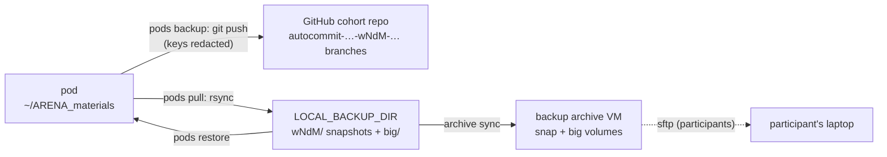

# Backups and the participants' work

How `arena` keeps what the participants make: the git backup every 15 minutes, the file
copies beside it, switching branches without losing anything, getting a pod's files back,
the archive that outlives the pods, and the reaper that only ever terminates after a verified
backup. The [README](../README.md) has the short tour; every other command is in
[REFERENCE.md](REFERENCE.md).



## Contents

- [`pods backup`: the full save](#pods-backup-the-full-save)
  - [Which pods](#which-pods)
  - [Flags, budgets and dry runs](#flags-budgets-and-dry-runs)
  - [What never goes into the commits](#what-never-goes-into-the-commits)
  - [Pasted keys are redacted](#pasted-keys-are-redacted)
  - [A failed push, and a pod pushing to the wrong repo](#a-failed-push-and-a-pod-pushing-to-the-wrong-repo)
  - [BUSY: an operation in progress](#busy-an-operation-in-progress)
  - [Auto-resolve: a BUSY pod left alone for 3 hours](#auto-resolve-a-busy-pod-left-alone-for-3-hours)
- [`pods set-branch`](#pods-set-branch)
  - [Each pod is backed up first](#each-pod-is-backed-up-first)
  - [On `main`/`master`](#on-mainmaster)
  - [What `--hard` saves before it resets](#what---hard-saves-before-it-resets)
  - [`DISCARD_MAX_GB`: too big to save first](#discard_max_gb-too-big-to-save-first)
  - [Redacted keys, and the switch's own bounds](#redacted-keys-and-the-switchs-own-bounds)
  - [Landing on `main`, and `--init-branches`](#landing-on-main-and---init-branches)
- [`pods init-branches`](#pods-init-branches)
- [`pods pull`: the file backup](#pods-pull-the-file-backup)
  - [`.git` is kept whole](#git-is-kept-whole)
  - [Hard-linked snapshots](#hard-linked-snapshots)
  - [Knobs, labels and the backup lock](#knobs-labels-and-the-backup-lock)
  - [Time limits](#time-limits)
  - [A directory that became a symlink](#a-directory-that-became-a-symlink)
  - [A repo on the `/workspace` volume](#a-repo-on-the-workspace-volume)
- [`pods baseline`](#pods-baseline)
- [`pods restore`](#pods-restore)
- [Moving a pod: `pods replace` / `pods migrate`](#moving-a-pod-pods-replace--pods-migrate)
- [Room on this box: `CONTROL_MIN_FREE_GB`](#room-on-this-box-control_min_free_gb)
  - [What arena leaves on the box](#what-arena-leaves-on-the-box)
- [`cron`: the lines that run it all](#cron-the-lines-that-run-it-all)
  - [Locks and logs](#locks-and-logs)
  - [Upgrading from older versions](#upgrading-from-older-versions)
  - [Homes and paths cron can't carry](#homes-and-paths-cron-cant-carry)
  - [`cron remove` and `cron show`](#cron-remove-and-cron-show)
- [Idle pods and the auto-reaper](#idle-pods-and-the-auto-reaper)
  - [`pods idle`](#pods-idle)
  - [`pods reap`](#pods-reap)
- [Backup archive (`arena archive`)](#backup-archive-arena-archive)
  - [How it works](#how-it-works)
  - [Commands](#commands)
  - [`archive sync`](#archive-sync)
  - [Resize, ssh, down](#resize-ssh-down)
  - [A rebuilt archive, and the participants' access](#a-rebuilt-archive-and-the-participants-access)
  - [State](#state)
  - [End of the program](#end-of-the-program)

## `pods backup`: the full save

`pods backup [targets]` — the **full save**: git-push the ARENA tree **and** rsync the home to the
local backups folder (`pull`). The git push is on **whatever branch the pod is on** (never
switches/creates one, so bespoke branches are respected) and **skips `main`/`master`**; clean trees
in step with origin's copy of the branch report `NO_CHANGES` (origin's — never the branch's own
upstream: a branch made from `upstream/main`, tracking it, is pushed like any other, its upstream
left as it is; a branch with none tracks origin's after its first push, written to its config even
where `remote.origin.fetch` is narrowed — `branch.<b>.remote` and `.merge` each on its own, so one
half-written, or set alone by the participant, gets the other at the next push; and every push sets
`refs/remotes/origin/<b>` to what it pushed, which a narrowed fetch never maps: such a checkout then
reads `NO_CHANGES` and scans only what's new, instead of pushing and re-scanning every commit since
origin's main each run).

### Which pods

Selected pods, or — none named (no targets, `all`/`--all`) — **this cohort's**: `<prefix>-…` pods
(one off `MACHINE_NAME_LIST` too: an extra pod made for someone, a parked `-old` twin), never an `@`
staff entry. The rest (staff boxes, another prefix, a pod the provider named) get one `⊘ skipped N
non-cohort pods (…): a, b — name one to include it, or pass --include-non-cohort` line, never a
failure; named, they're backed up like any pod (list a staff box that wears the prefix as
`@<prefix>-name` to leave it out).

`--include-non-cohort` (on `backup`, `pull`, `init-branches`, `set-branch`) takes every pod instead.

Cohort pods on `main`/`master` (after `set-branch main`, until `init-branches`) get one line after
the run, not a SKIP each: ``⚠ 12 cohort pods on main: not backed up until `arena pods init-branches`
`` (it names the pods when only some are). Not a failure — the exit stays 0: the reset window is
routine every morning, and a daily non-zero exit would bury the ones that mean a push broke.

### Flags, budgets and dry runs

`--no-pull` = git only; `--message` overrides the commit message. Confirms first (`--dry-run`
previews both). Each pod's git push has a 5-min budget, its rsync the `pull` budgets below. To stage
onto a dated autocommit branch, run `pods init-branches` first.

### What never goes into the commits

Two things never go into the commits, because each once kept participants' work off GitHub: **files
over 95 MB** (GitHub refuses the push, and every later one — GH001) are left out (never staged, so
no blob is written), stay on disk and are reported per pod (`skipped N file(s) > 95 MB: … covered by
the rsync big tier`); a branch whose unpushed commits already carry a file over GitHub's own 100 MiB
limit fails with the exact fix (`arena pods run -t <pod> 'git -C <repo> reset -q <sha>'` — keeps
every file on disk; the next backup re-commits the work without it), never the same opaque rejection
every tick (a 95–100 MB file committed by hand is one GitHub takes: it's pushed).

And **nested repos are never committed as gitlinks** (a commit id without its files): the image's
nested clones (no commits of their own) are **adopted** once per checkout — the course repo tracks
their files where they are (listed in `.git/arena-nested`), so work inside them is committed like
everything else, while each clone keeps its own `.git` untouched: git run inside an exercise still
works on that clone alone (never on the whole course repo), and its stashes, branches and reflog
stay in it, backed up by the rsync tiers like every `.git` (and carried by `pods replace`). Nothing
on disk changes; to undo, `git rm -r -q --cached <dir>` and delete its line from
`.git/arena-nested`.

A nested repo with its own history (a participant's project), or one cloned after that, is left
exactly as it is, kept out of the commit (a managed block in `.git/info/exclude`) and reported every
run (the rsync tiers have it). A gitlink an earlier backup committed is replaced by the files. A
file over the limit staged by hand (`git add`) is taken back out of the index the same way.

The script runs under `sh` whatever the login shell; `--dry-run` prints each pod's line — `ssh … 'sh
-s <exact arguments>' < arena-backup.sh` — and, once, the here-doc that writes `arena-backup.sh`:
paste that first and every line runs as the backup would (without it the shell refuses to start,
never a silent no-op).

### Pasted keys are redacted

**A pasted key never blocks the push** (live: an OpenRouter key in an exercise made GitHub refuse
three pods' pushes for ~20 hours, GH013): each new or changed text file is scanned for
high-confidence key formats (`arena_core::backup::SECRET_PATTERNS`: OpenRouter, Anthropic, OpenAI,
Hugging Face, GitHub, AWS) and committed with each key replaced by `REDACTED-…` — in git only: the
file on disk keeps the key (the code still runs) and shows as modified; reported per pod (`redacted
N pasted key(s) in …`).

**Unpushed commits holding a key** — in a file or in the commit message; an older backup's, or one
the participant made by hand — are rewritten before the push, whatever GitHub would do: just those
commits and the ones on top of them (none origin has — one only the course's `upstream` has, its
`main` merged in, is scanned too: origin never had it), the key redacted — same messages (a key in
one redacted the same way), authors, dates — and pushed as a fast-forward, never forced, the commit
alone (`--no-follow-tags`: a participant's `push.followTags` sent the annotated tags on it too,
their messages unscanned); files on disk untouched.

**Right before the push, what goes out is scanned once more**, fail closed (FIX10): any key still in
those commits or files — in a commit's author, committer or merged signed tag (headers the rewrite
doesn't touch), in a binary file or a symlink (never rewritten), or one a redaction missed — and
nothing is pushed: `✗ <pod>: a key is still in the unpushed commits of <branch> after the redaction
— … so nothing was pushed. Take it out of those commits on <pod> by hand`, the pod rsynced as for a
refused push, every run until it's out.

`init-branches` pushes only a commit origin already has, and checks so before its push (else nothing
pushed, exit 1).

**The course's own commits get no exemption** (FIX8): every exemption tried (FIX4B to FIX7) trusted
something a pod could get wrong, and Live 7 found no key-like string in the real course's 2187
commits. What that leaves: if the course ever commits a key-like string, each pod that merges it
pushes those commits rewritten redacted, and a later `git pull upstream main` may conflict on those
lines — the fix is to take the string out of the course.

And a course string GitHub's push protection knows but the redaction doesn't fails the push on every
pod that pulls it (`GitHub push protection refuses …: a secret the backup doesn't redact`, each such
pod rsynced instead, every run): fix it at the source — take it out of the course — or allow it in
the cohort repo's push protection; rewriting each participant's history by hand isn't the fix
(review claude #6).

A secret the patterns don't know, refused by GitHub, fails the pod with GitHub's name for it and its
path:line (never the secret, never GitHub's allow-URL).

### A failed push, and a pod pushing to the wrong repo

**A pod whose push itself fails** (a refusal, a big file, the network) **is rsynced into
`LOCAL_BACKUP_DIR` in the same run — even under `--no-pull`** (the cron's) — and its line says where
its files went (or why that failed too); the run still fails.

A pod that fails before its push (no repo, ssh refused, a timeout) keeps its plain failure line and
isn't copied every 15 minutes.

**A pod whose `origin` isn't the configured repo** (`ARENA_REPO_OWNER`/`ARENA_REPO_NAME`; any
spelling of it passes: scp-style, `ssh://`, `https://` with or without credentials, `.git`, a
trailing slash, any case) is refused before anything else, `main` included (live: a pod nobody set
up kept the upstream course repo and was never backed up to git, silently): nothing committed or
pushed, `` ✗ <pod>: origin is <url>, not the configured <owner>/<name> — not backed up to git; run
`arena pods setup <pod>` `` (the URL never with its credentials), and the run fails. Its work
reaches no git remote at all, so it is rsynced like a failed push, even under `--no-pull`.
`set-branch` and `init-branches` don't switch it, and the reaper doesn't reap it until `pods setup`.
No configured repo: no check.

### BUSY: an operation in progress

**A branch with an operation in progress** — a participant mid-way through a conflicted `git pull
upstream main` (a merge), a cherry-pick or a revert, a `git am` (HEAD attached; a patch that didn't
apply leaves no conflict at all), a rebase that kept HEAD attached, a multi-commit cherry-pick or
revert paused between its commits (git's `sequencer/` alone, once one was resolved and committed by
hand), or with the conflicts a `git stash pop` left — is left exactly as it is (review R3: the
backup committed the conflict markers as a merge commit and pushed it, after which `git merge
--abort` and VS Code's conflict view no longer worked): nothing staged, committed or pushed (`BUSY`,
exit 6), `` ✗ <pod>: a merge is in progress on <branch> — not committed (a backup now would commit
the merge's state, unresolved conflicts and all, and end the merge); resolve the conflicts and `git
add` them, then `git commit` — or abort it (`git merge --abort`) on the pod ``.

Conflicts are named only while some are unresolved (git refuses the commit until they're added);
with none left (all resolved and added, or a clean `git merge --no-commit` / `git revert -n`) it's
`` … commit the merge's state and end the merge); finish it (`git commit`) or abort it (`git merge
--abort`) ``.

A cherry-pick, a revert, a `git am` (`BUSY <branch> am`) and a rebase each get their own
`--continue`/`--abort`; a paused sequence (`sequence`) names both `git cherry-pick --continue` and
`git revert --continue`, since only the right one works; a `git stash pop`'s conflicts `` resolve
them and `git add` them, or undo them (`git reset --merge`) ``. The run fails.

The check runs again right before the staging and right before the commit, so an operation the
participant starts while the backup scans is caught too (what's left is the instant before git takes
its index lock: git has no lock that spans commands).

#### Copied, not every tick

It is rsynced like a failed push, even under `--no-pull`, until it's ended — but not every tick: a
read-only look at the pod first (under its lock) says whether anything changed, and it is copied
only when no copy since the operation started is recorded — or the recorded copy is gone from this
machine (its `.git` no longer there), or isn't under `LOCAL_BACKUP_DIR` as it is now (compared as
real paths: the record holds the copy's own, every link resolved, so a dir spelled through a link or
relative to the working directory is the same dir) —, when its work tree changed since the last
recorded copy (every file git lists: mtime, size, ctime and path, so a `cp -p`/`rsync -a`
replacement that keeps the old mtime and size counts too), or when that copy is an hour old; else
its line says so (`✗ <pod>: not backed up to git (…) — copied at 14:02 UTC to <dir>/w2d1/<pod>,
unchanged since`).

So a course push that leaves many pods conflicted can't make one cron tick outlast the next (whose
`flock -n` would skip the healthy pods' backups too).

A copy counts only when it is whole: every rsync of both tiers, the snapshot's uncapped `.git` pass
among them (a busy lock, no endpoint, a timeout, a failed tier or pass: no copy).

The record is `busy-copies.json` in the fleet's state dir (written atomically, owner-only, off the
async runtime under the state dir's lock, waited for 10 s at most; missing or corrupt = copy again).

(The reaper doesn't reap such a pod meanwhile: its git step fails, retried every 6 h, and the run's
table and its notification say `a merge is in progress on <branch> — not reaped until it's finished
or aborted` with how to end it, while `reap log` and `reap status` keep their fixed words:
`git_failed`, `backoff_after_failure`.)

The backup after that commits as always. A rebase detaches HEAD, so it is skipped like `main` — and
said (`UNCOMMITTED HEAD rebase`), so `set-branch --hard` copies it first.

### Auto-resolve: a BUSY pod left alone for 3 hours

**Left alone, it is finished** — `BUSY_AUTO_RESOLVE_HOURS` whole hours (default 3; `0`/`off`:
never), the human's rule (2026-10-19: "backup files + some automated heuristic … whatever changes
are most recent … after like 3h of no activity"), applied per file and per hunk so that neither
side's work is silently lost.

#### When it counts as left alone

It needs all of these older than that, on the pod's own clock: the operation's start (its
`MERGE_HEAD`/`CHERRY_PICK_HEAD`; the index for a stash pop's conflicts), every file git lists
(tracked, and untracked but not ignored; never `.git`), the index (something staged), any terminal
login's typing (`who`'s ttys) and any pseudo-terminal's use (`/dev/pts/N`, read directly: the
images' containers have no utmp, and VS Code's, Jupyter's and tmux's terminals are no login); and
nothing at work in git — no `.git/index.lock`, no `git` running, no process holding `MERGE_MSG`,
`COMMIT_EDITMSG`, `git-rebase-todo` or `SQUASH_MSG` (an editor a git command waits on).

Unsaved buffers in an editor or a notebook can't be seen: only what reaches the disk counts — the
copy and the folder below hold the state before.

It also needs a whole copy recorded after the work tree's last change, `.git` with it (this run's or
an earlier one's, still there — never when this run's copy failed); a repo linked onto the
`/workspace` volume counts as held by a pull of the home, which copies it in the link's place.

A pod whose operation is older than that but held back says why, each run, besides its BUSY line —
what changed or was used, how long ago on the pod's clock: `⊘ <pod>: not finished automatically —
notes.py changed 40 min ago — it waits for 3h of quiet` (or git's index written, something staged or
a `git status` refreshing it; a terminal used; a login typing; the index locked; a git command
running; this run's copy failed; no copy recorded after its last change); one whose operation is
younger isn't a candidate yet, and gets no such line.

#### How each conflicted path is settled

Then, on the pod, under its lock, each conflicted path, nothing changed yet:

- a regular text file with no conflict marker left (at the path's `conflict-marker-size`), both
  sides there, is kept as the participant resolved it;
- one whose markers are still there but which isn't what the merge left — git's conflicted output
  made again from its stages (`git merge-file` with the file's own labels and marker size,
  `--diff3`/`--zdiff3` for base sections; else the merge's own way, `checkout --conflict` into a
  scratch tree, labels aside) — leaves the whole operation BUSY: `⊘ <pod>: not finished
  automatically — you started resolving x.py by hand — finish it (and git add it) or abort, on the
  pod`; so does one that can't be compared (a marker line or its label deleted, or a binary side:
  `can't tell whether you started resolving x.py by hand …`), however soon after the operation it
  was written;
- else it takes the side whose last change to that path is the more recent (`git log -1 --format=%ct <side>
  -- <path>`, HEAD against `MERGE_HEAD`/`CHERRY_PICK_HEAD` or the stash entry; a tie keeps
  HEAD's; a path renamed on one side counts from that side's own commit): a text file per hunk (`git
  merge-file --ours|--theirs`: that side of each conflict, the clean changes of both sides kept — so
  a course fix elsewhere in the file is never recorded as merged and dropped), a binary file, a
  symlink or a modify/delete whole, a path that side deleted removed. A notebook (`*.ipynb`) merged
  per hunk must still parse as JSON (python3's json, run isolated — `-I`, so a participant's
  `json.py` at the checkout's top is never imported nor a `__pycache__` written there — else jq):
  one side's conflict beside the other side's clean hunk can leave a bracket or a comma wrong, and
  Jupyter wouldn't open it. Then — or when nothing on the pod can tell (no python3 or jq, or one
  that fails some other way than "not JSON": a broken conda shim) — it stays BUSY, `x.ipynb can't be
  merged per hunk into valid JSON — resolve it in Jupyter, or abort`: never taken whole from one
  side, which would drop the other side's changes to it. A notebook resolved by hand that doesn't
  parse (or can't be checked) leaves it BUSY too (`x.ipynb isn't valid JSON: …`).

A file over 95 MB anywhere in that, or conflict markers the participant already staged (`git add` of
a file still in conflict), leaves it BUSY, said.

A merge's or a cherry-pick's commit takes the whole index, so every path staged against HEAD counts,
not only the conflicted ones — a file resolved or added and `git add`ed before: a blob over 95 MB, a
nested repo staged as a gitlink (not a submodule the staged `.gitmodules` lists, as the backup's own
check reads it), or a notebook that isn't valid JSON (or can't be checked) leaves it BUSY too
(`model.pt is staged at … bytes, over git's …-byte limit: never committed — unstage it, or abort, on
the pod`) — and so does any new gitlink while `.gitmodules` is itself in conflict (`.gitmodules is
in conflict and the merge brings a submodule — resolve it by hand`: which side's list the commit
takes isn't known until then).

What the other side brings as it has it, the participant never staged, and the words say so (`…
comes in from the merged branch (MERGE_HEAD) at … bytes, …: arena won't commit it — finish the merge
yourself, or abort it, on the pod`); what is staged exactly as the other side has it — taken whole,
merged per hunk, or by hand into that very blob — is sized by GitHub's 100 MiB instead, as the
backup sizes what it pushes (its blob goes out with the other side's commit anyway), so a course
file between the two goes in.

#### What it keeps first, and what it checks again

The state before is kept first in `.git/arena-resolved/<UTC stamp>/` on the pod — the conflicted
files as they were, git's own `MERGE_HEAD`/`MERGE_MSG`/`CHERRY_PICK_HEAD`/`ORIG_HEAD`, the old HEAD,
the index with its conflicts, and a README that says how to see it or do it again — which no later
copy overwrites (the day's snapshot is updated by every pull that day).

Right before anything changes, the state is read again (the operation and its commit, HEAD, the
conflicts, the index's mtime and size, every file, no index lock), and every condition of quiet
asked again (a terminal used, a login typing, a git command running — someone back at a terminal,
typing into a buffer not saved yet, touches no file): any difference — the participant aborted the
merge, started a rebase, staged a file, used a terminal — and nothing is touched.

For a merge or a cherry-pick, every staged regular file the participant made — neither HEAD's
version nor the other side's: resolved by hand (now, or added before), merged per hunk into
something of both sides, added mid-merge — goes through the backup's key redaction (the redacted
blob is committed, the file on disk keeps its key). What is staged exactly as `MERGE_HEAD` or
`CHERRY_PICK_HEAD` has it goes in as that side has it, whoever's side it is: the backup after it
scans every commit origin doesn't have, that side's and the resolve's own, and rewrites one holding
a key redacted before anything is pushed (FIX8; the course's own commits are no exception, above).
(A stash pop's conflicts make no commit there: the backup after redacts what it commits.)

Right before the commit the operation, HEAD and the index lock are checked once more, every staged
path's size and kind again — on the index taken as a tree first and again after those checks
(anything staged meanwhile stops it, `the index changed while arena was checking it — nothing
committed`: review ai-review codex #2, claude #5) — and the tree the commit must take is that one,
redacted apart, which the index must still come out as right before the commit: a `git add` the
participant finishes after the checks — a key, a big file, a nested repo none of them saw — stops
it, `the index changed while arena was finishing it — nothing committed`.

#### The commit, and what it never finishes

A merge becomes a real merge commit, a cherry-pick is `--continue`d (one left empty is committed
empty, as git advises), a stash pop's conflicts are added (its stash entry stays) — in the repo's
own identity, never `-c user.*` — the message saying, per path, which side won and both sides' last
change to it, UTC to the minute (`- README.md: the merged branch won (its side of each conflict; the
other changes of both sides kept) — last changed: yours (HEAD) 2026-10-19 09:12Z, the merged branch
(MERGE_HEAD) 2026-10-20 13:05Z`), then where the state before is and today's copy.

The resolve looks again first and touches nothing if anything changed since the look its copy
followed (`⊘ <pod>: not finished automatically — changed: files changed since the copy`).

Then the pod is backed up again in the same run, as any — `✓ <pod> -> <branch> — finished a merge
left for 3h+ (README.md: MERGE_HEAD's side of each conflict, HEAD 2026-10-19 09:12Z / MERGE_HEAD
2026-10-20 13:05Z; notes.py: as resolved by hand; before: <repo>/.git/arena-resolved/…/ on the pod;
today's copy: <dir>/w2d1/<pod>)` — and it isn't a failure of the run (only the pods finished come
off the run's failures; any other pod that failed stays one).

Never a revert (`⊘ <pod>: not finished automatically — arena won't finish a revert …`: its other
side is the commit it undoes, always older, so the newer side would undo nothing), a `git am`, a
rebase or a sequence (what they'd go on to apply is the participant's), nor anything unusual —
conflicts not from the newest stash entry, a submodule in conflict, a merge of several branches, no
git identity in the repo: those stay BUSY.

The TUI's backup and the reaper's git step copy nothing first, so they don't finish one; the next
cron backup does, and the reaper's retry then finds the pod backed up.

The resolve runs under `sh` on the pod, whatever its login shell, bounded there by `timeout` (270 s,
then a KILL 10 s later — under arena's own 5-minute timeout, which kills only the local ssh client),
so it has ended before arena reports a timeout and lets go of the pod's lock; stopped so, its line
says it may have stopped part-way.

A HUP, INT, TERM or broken pipe removes its temporary files from the git dir; a KILL doesn't.
Nothing tells the participant but the commit and the folder (the reaper's `~/.arena/NOTICE` is its
own).

## `pods set-branch`

`pods set-branch <branch> <targets|--all> [--hard] [--init-branches]` — switch pods' ARENA checkout
to a branch. Gentle by default (fetch origin + checkout + fast-forward to origin's branch, by name —
fails on a diverged/dirty tree rather than clobbering work, and all or nothing: when the checkout
went through but the fast-forward didn't (the local branch has commits origin's doesn't — Live 4: a
local `main` made from `upstream/main` — or origin has no such branch), the pod goes back to the
branch it was on, and its line says why and `back on <branch>` (or, if going back fails too, which
branch it is on now); never the local branch's own upstream, so a participant's `feat` tracking
`upstream/feat` lands on origin's, and an unreachable `upstream` doesn't matter).

**`--hard` is destructive**: force the branch to match `origin/<branch>`, discarding local
commits/changes — and overwriting any untracked file at a path `origin/<branch>` tracks (other
untracked files stay) — e.g. `set-branch main --all --hard` resets the fleet to `main`.

Confirms first; `--dry-run` previews. Pods switch concurrently, 2-min budget each.

A nested clone the backup adopted (see `pods backup`) is tracked only on the autocommit branches, so
a switch to `main` would delete it from disk and break that exercise: it is put back from the
previous HEAD, **staged** (so switching back goes through), and named per pod (`restored 2 nested
repos that main doesn't track (Grokking, …): on disk and staged; the first backup on the next day
branch commits them`).

`--all` = this cohort's pods, as for `backup` (a staff box only when named).

### Each pod is backed up first

Each pod's current branch is **backed up first** (the `backup` commit + push, keys redacted; a no-op
on `main` or a branch in sync), under the pod's backup lock, held until its switch ends (only with
an absolute `LOCAL_BACKUP_DIR` that exists: with a relative one, such as the legacy `./backup`, no
lock is taken, and the dry run and the run say so in one line).

A pod whose push fails is rsynced into `LOCAL_BACKUP_DIR` first, then switched, its line saying so
(its unpushed commits stay in that branch on the pod — or, after `--hard` onto that same branch,
under the ref `refs/arena-discarded/<UTC time>-<branch>` the switch pins them with); a pod that can
be **neither pushed nor copied** (the copy failed too, the backup failed before its push, or another
backup held its lock for the whole 2-min wait) is **not switched** (`✗ … not switched: <why>`), and
the run fails.

A pod with an operation in progress on a branch the backup commits (a merge, …: see `pods backup`)
is copied first the same way, its line saying `⚠ NOT COMMITTED FIRST: a merge is in progress on <branch>…`;
the gentle switch then refuses to end it (`arena set-branch: a merge is in progress on <branch>
— not switched (a switch now would end the merge); <how to end it> on the pod, then switch
again`, exit 6 — git's own checkout would drop a merge whose conflicts are staged; the TUI's
set-branch says the same, naming `--hard` as the destructive way), and `--hard` ends it, discarding
its uncommitted changes to tracked files, its line saying where the copy went (a `git am`, rebase or
paused sequence too: git keeps their state across a checkout, so once switched `--hard` quits it —
its state only — rather than let it stop the next init and every backup, or a later `git rebase
--abort` take the pod back off `main`).

### On `main`/`master`

On `main`/`master` (or a detached HEAD) no backup commits or pushes: the backup there only says what
a reset could discard — the first of an operation in progress, changes to tracked files (compared
through a copy of the index, so the participant's own is never written), commits no remote has (one
only `upstream` has is the course's, not lost), untracked files git doesn't ignore — and **`--hard`
copies such a pod first** too, `.git` and all (`⚠ NOT COMMITTED FIRST: main has uncommitted changes
to tracked files, and no backup commits on main; …`, `⚠ NOT PUSHED FIRST: main has commits no remote
has, and no backup pushes main; … that copy has its .git, those commits with it; …`), never
resetting it if the copy fails.

Any untracked file counts: `--hard` overwrites one wherever the branch it resets to tracks the same
path (review pr4: a participant's `solutions.py` became the staff's), and which paths that branch
tracks after the switch's own fetch the backup can't know. A nested repo doesn't (the image ships
clones like that), nor does an ignored file.

A pod with nothing of its own on main — main as on origin — isn't copied, and `pods backup` and the
cron say nothing of any of it.

A pod `--hard` switched after copying such work is switched, not a failure; one line after the run
names those pods.

### What `--hard` saves before it resets

**Before any `--hard` reset, what it discards is saved on the pod** — in `.git/arena-discarded/<UTC
time>/`: `changes.patch` (HEAD → the files), and `staged.patch` (HEAD → the index) and
`unstaged.patch` (the index → the files) apart — a version staged and then undone in the files is in
the staged one only (on `main` and the other branches no backup commits; on a branch the backup
commits, see below) —, the files with unresolved conflicts, the operation's state (`MERGE_HEAD`,
`MERGE_MSG`, `rebase-merge/`, …), the untracked or ignored files, links and directories the reset
removes (a directory where the branch has a file or a link goes whole — ignored contents, a nested
repo's `.git` and all — so it's copied whole, its links kept as links; a big one costs its size
there), and a README on getting them back (`git apply --index …staged.patch && git apply
…unstaged.patch` on the commit it was on, which it names; the ref `refs/arena-discarded/<UTC time>`
keeps that commit from git's gc — `git update-ref -d` it, and remove the folder, once it's not
wanted) — and the pod's line says `what it discarded was saved to .git/arena-discarded/<time>/ on
the pod first`.

**The commits the reset leaves on no branch are pinned too** (review ai-review codex #3: `checkout
-f -B <branch> origin/<branch>` moves the local `<branch>`, whichever branch the pod was on — a pod
on a clean, pushed autocommit branch lost an unpushed commit on its local `main` to git's gc once
the reflog expired): the local `<branch>`'s tip, when it has commits origin's doesn't, as
`refs/arena-discarded/<UTC time>-<branch>`, and the commit HEAD was on, when it has commits no
remote has, as `refs/arena-discarded/<UTC time>` — whether or not anything else is saved (then the
folder holds just the README, naming them and how to make a branch of each again); the pod's line
names the refs (`its commits kept by …`), and the README's last line deletes them all.

In `.git`, so the reset doesn't touch it and every later copy (snapshot, big, archive) carries it
under a name no later save reuses: the copy into `LOCAL_BACKUP_DIR` is the day's label, which the
next pull of that label overwrites from the reset pod (review ai-review claude #2).

What no save can keep (review ai-review codex #2, not taken: inherent to the backup): on a branch
the backup commits, a version staged and then changed again on disk. The backup `set-branch` runs
first is the ordinary one, whose `git add -A` stages each file as it is on disk — as every */15
backup does — so the staged version is replaced before the save runs (what is on disk is committed
and pushed instead); `--hard`'s first backup is no different from the cron's next one.

Nothing to discard, no folder; a save that fails leaves the pod as it was, not reset (a failed
switch), and removes what it had copied, refs and all. So does a save the switch is stopped in the
middle of — its 100 s bound's TERM, a dropped connection (review ai-review claude #2: a 30 GB
directory's copy never finished, and each try left another partial copy in `.git`): the switch's
exit trap puts the keys back, then removes it (a KILL runs no trap), and says what it was saving —
stopped mid-copy, what and how big, and the same move out of the way as below (claude #6).

### `DISCARD_MAX_GB`: too big to save first

And what `untracked/` would hold is totalled first (`du -sk`): over `DISCARD_MAX_GB` (in GiB, binary
as `du` counts — a fraction too, `0.5`; every size said in GiB/MiB/KiB; default 1: the save runs
within the switch's 100 s — review ai-review claude #6; `config check` shows it; settable from the
environment for one run, `DISCARD_MAX_GB=0.5 arena pods set-branch main <pod> --hard`, even when the
file lacks it, and `config check` says it came from there) or over half what's free on that disk
(`df`), nothing of it is copied and the pod isn't reset — `arena set-branch: not reset — the --hard
reset would remove checkpoints (31.2 GiB), which is more than DISCARD_MAX_GB allows (1.0 GiB) to
save first: move it out of the checkout (cd '/root/ARENA_materials' && if [ -e
'../checkpoints.kept-20261020T071500Z' ] || [ -L '../checkpoints.kept-20261020T071500Z' ]; then
printf '%s\n' 'not moved: ../checkpoints.kept-20261020T071500Z exists' >&2; exit 1; fi && mv -n --
'checkpoints' '../checkpoints.kept-20261020T071500Z'), or delete it, then switch again` — every word
quoted (a `'` in a path pastes as it is), the kept copy under a name of its own, never over an
earlier one nor into it: pasted twice, the second paste fails, moves nothing and says so (`not
moved: ../checkpoints.kept-… exists`; review ai-review claude #5, codex #4, claude #7; plain POSIX,
busybox's `mv` too).

`--hard` with `--include-non-cohort` is refused unless the pods are named: it would reset staff
boxes and other cohorts' pods too.

### Redacted keys, and the switch's own bounds

A file the backup committed with a key redacted keeps the real key on disk: around the switch it's
set aside in `.git/arena-unredacted/<time>-<pid>/` (so gentle doesn't refuse it and `--hard` doesn't
drop the key; a later set-aside never overwrites an earlier one) and put back when the pod returns
to that branch.

A gentle switch that refuses a pod mid-merge does so before setting anything aside, and the putting
back is the command's exit trap: a switch that fails, stops on an error, or gets a hangup, an
interrupt or a TERM puts the keys back first.

arena's own 2-minute timeout kills only its ssh client — a non-pty session's shell is usually never
signalled, and ran on (review ai-review claude #13) — so the switch bounds itself on the pod: it
runs under `timeout` for 100 s (TERM, the keys put back; KILL 10 s later if still running, which
runs no trap: keys then stay set aside until a switch back to their branch), said on the pod's line
if it ran out; a pod without coreutils' `timeout` runs it unbounded.

Its script runs under `sh`, whatever the login shell (zsh on the pods): the command sshd hands the
login shell is one simple command, `sh -c '<wrapper>' arena-set-branch '<script>'`, quoted so bash,
zsh and fish all read it the same (review ai-review claude #11: fish refused the old
assignment-and-`if` wrapper); the wrapper, under `sh`, holds the `timeout` probe and fallback.

### Landing on `main`, and `--init-branches`

Landing pods on `main`/`master` ends with the reminder ``⚠ N cohort pods on main: not backed up
until `arena pods init-branches` ``; `--init-branches` then runs `init-branches` on every pod that
switched (the start date is checked first) — one copied first because its push failed included,
whatever failed it (the network, push protection, a non-fast-forward, an operation in progress): one
participant's failed push used to leave the whole fleet on main, where no backup commits (review
pr4).

The run still fails afterwards, naming the pods copied instead of pushed.

A pod that didn't switch (no copy, its switch failed, the gentle switch refused it, its lock stayed
busy, the wrong origin) is left out of the init — `init-branches on the N pod(s) that switched — not
on …` — and fails the run too; with none switched, no init.

## `pods init-branches`

`pods init-branches` — create each pod's `autocommit-…-wNdM-…` branch and push it upstream **without
committing** (legacy `init_branches`), so a new day's branch exists before `backup` runs.
`--week`/`--day` override; `--dry-run` previews. 2-min budget per pod.

A pod still on another branch has it backed up first, as `set-branch` does (and isn't switched if it
can be neither pushed nor copied).

It pushes only commits origin already has, by id — never one no backup has scanned (review claude
#2: a pod whose backup push had failed, rsynced and switched anyway, sent yesterday's unscanned
commits out with the new branch): if the new branch holds commits origin doesn't, it goes to origin
at the newest commit origin has (or isn't pushed at all, when origin has none of it), and the rest
stay on it on the pod, said on its line (`— 2 commit(s) origin doesn't have stay on it on the pod,
unpushed (…): the next backup scans them for keys and pushes them`).

A pod with an operation in progress (a merge, cherry-pick, revert, `git am`, rebase, paused
sequence, conflicts) is refused, touching nothing (`arena init-branches: a merge is in progress on <branch>
— not switched …`, exit 6): `git checkout -b` would drop the merge and carry its conflicts
onto the new branch, with nothing left to abort — and carry a `git am`, rebase or sequence onto it
half-done.

Landing on a day branch that exists, it puts back the real keys a switch set aside on it; its script
runs under `sh`, whatever the login shell (zsh on the pods, where a glob with no match is fatal: a
set-aside run left without its `.branch` ended the whole command before the push), bounded on the
pod like `set-branch`'s switch (100 s, then a KILL 10 s later), through the same one simple command.

No targets = this cohort's pods, as for `backup`.

## `pods pull`: the file backup

`pods pull [targets] [--label <label>]` — the **file** backup (complementing the git `backup`):
rsyncs each pod's home into `<dir>/<label>/<pod>/`, reporting per pod what was sent and what the
snapshot holds (`12 files, 3.4M sent of 6754, 1.8G` — sizes parsed in every format rsync prints). No
targets = this cohort's pods, as for `backup` (a staff box only when named). Targets are positional
like every command's (the old `-t` still works, and so does `pods pull w1d3` — read as the label,
with a note — when `w1d3` names no pod).

### `.git` is kept whole

**Keeps `.git`, complete** (`--no-git` to skip): the size cap (`--max-size`) applies to the files,
then a second pass copies every kept `.git` uncapped — a repo's big pack used to be dropped, leaving
refs to missing objects — and the empty dirs inside a `.git` (`refs/heads/` once refs are packed)
are kept, so each snapshot (and `big/`) is a repo git reads. Excludes other dotfile dirs +
`site-packages`.

### Hard-linked snapshots

**Hard-linked snapshots**: each dated snapshot is still a complete tree (restore/pull layout
unchanged), but files unchanged since this pod's previous snapshot, or identical to the week's
**fleet baseline** (`pods baseline`), are hard links (`rsync --link-dest`, absolute paths, same
filesystem — all under `<dir>`), not copies: a day's snapshot costs only what changed, a new or
replaced pod's first one only what isn't the image's.

A linked file is one inode in every snapshot sharing it, so a pull into a label that already has
files (the */15 cron pulls into the day's label all day) never changes an existing file's mode or
owner in place (`--no-perms --no-owner --no-group`): a `chmod` on the pod used to rewrite the mode
in every earlier snapshot (and, through the baseline, other pods'); now a mode-only change made
after the day's first pull shows from the next label on, and earlier snapshots stay exactly as they
were (a changed file is always a new file).

The run ends with each snapshot's real cost (`1.8G in 6754 files, 12.0M of it new on disk`); `du -sh <dir>/*`
in one invocation counts a hard-linked file once.

### Knobs, labels and the backup lock

Knobs come from flags else config: `LOCAL_BACKUP_DIR` (`--dir`), `BACKUP_MAX_SIZE` (`--max-size`),
`BACKUP_REMOTE_PATH` (`--remote-path`, default `~/`). Label defaults to the `wNdM` iteration
(`big`/`baseline`/`reaped` are refused).

Confirms first; `--dry-run` prints the exact rsync commands, shell-quoted.

**Per-pod backup lock** (in an existing absolute `LOCAL_BACKUP_DIR`: `.arena-locks/<name>.lock`, the
folder 0700 — a missing backup dir is never created for it, and the run goes as before without
locks): each pod's lock is taken once per name (two listed pods sharing a name share it) and
released the moment that pod's own rsyncs end, so one slow pod never holds the others; `pods backup`
holds it for that pod's git push, then for its rsyncs.

A pod whose lock another backup (the cron, the reaper, the TUI's backup) holds for 120 s is skipped,
named, and fails the run.

### Time limits

**Bounded**: rsync `--timeout=300` (gives up after 5 min without any I/O) and a wall-clock budget
per pod, `BACKUP_TIMEOUT_SECS` (default 7200 = 2 h, max a day; settable from the environment) — a
pod that runs out is stopped (SIGTERM, so rsync takes its ssh and receiver down too; SIGKILL 2 s
later) before the failure is reported — so nothing is left running even when it was the last job and
arena exits right after — and named in the failure (`✗ arena9-bloom [big]: timed out after 7200s`);
the other pods finish, and the next run continues incrementally.

### A directory that became a symlink

**A directory where the pod now has a symlink** (or a file) — rsync's `could not make way for new
symlink: ARENA_3.0`, exit 23, every run (live: 9 pods' `[big]`) — is moved aside into a holding
directory beside it, its name kept: `.arena-olddir-<YYYYMMDD UTC>/ARENA_3.0` (`-2`, `-3`… if that's
taken), at any depth and in any tier; nothing is deleted.

Keeping the name keeps every name-based filter matching inside it (the archive's secret excludes:
`hf/token`, `.git/config`, …), and the archive never takes a moved-aside directory at all.

Only rsync's exit 23 is acted on; a pod can print the line itself (its ssh session's output reaches
rsync's stderr), but that only ever moves one of its own backed-up directories aside, never deletes.
Then that rsync runs once more within the same budget, and the pod's line says what moved.

The path comes from rsync's stderr, so only a plain path inside the destination is acted on: never
`..` or an absolute path, never through a symlink, and only a real directory is moved. (`--force`
would have deleted the backed-up directory.) The reaper's own copy does the same.

### A repo on the `/workspace` volume

A repo that setup **linked onto the `/workspace` volume** is still backed up as its tree (rsync `-a`
copies a link as a link): each pod is first asked (20s) where its repo really is, and a linked one
is left out of the pull and pulled from its real path into the same place
(`<dir>/<label>/<pod>/ARENA_materials/`), so the backup looks as it always did; a pod that doesn't
answer gets its repo pulled through its configured path (`ARENA_materials/`, which follows a link).

The same holds for a `--remote-path`/`BACKUP_REMOTE_PATH` that is the home (`~/`, `/root/`, `.`),
holds the repo (`/root` → `<pod>/root/ARENA_materials/`) or names it without a trailing slash
(`ARENA_materials`); one that can't be judged (`$VAR`, a glob, `..` — rsync escapes `$`, so `$HOME/`
never meant the home) is pulled as given, with a warning for each pod whose repo is a link.

The image's checkout that setup moved aside (`*.arena-aside-*`) isn't backed up — only an untouched
image checkout is ever moved aside after a reset (see `pods setup`). `pods replace`/`migrate copy`
carry the repo the same way (direct and via local staging), into the new pod's own volume copy when
it has one.

## `pods baseline`

`pods baseline <pod> [--week N] [--dir] [--replace] [--dry-run]` — capture the week's **fleet
baseline** into `<dir>/baseline/w<N>/fleet/`: the image's own files, which every pod's snapshots
hard-link to (see `pods pull`). Run it once a week (or after an image change) on a pod `up` just
made — its container must say when it was created and be under a day old, else it's refused (so is a
stopped pod: its listed endpoint is stale).

It rsyncs the pod's home with the snapshot tier's filters (linked to last week's baseline), then
**keeps only the files older than the container**: a hard link is made on equal size + mtime +
permissions, contents are never compared, so a file written at setup or later (`~/.name`, the API
keys in `.bashrc`, a script's output on several pods in one second) could otherwise stand in for
another pod's different file.

Nor any file **copied onto the pod since** with an older mtime kept — a `pods replace`/ `migrate`
copy of another pod's home (`rsync -a`), a `pods restore`, an archive setup unpacked: the pod lists
them first (`find` for a ctime after the container's creation with an mtime before it — an image
file's ctime is its layer's unpacking), and they're left out too, so even a replaced pod gives a
clean baseline; a listing that fails or is cut short refuses the capture.

A repo on the `/workspace` volume is left out (a volume can hold work older than the container).

Captured into a partial dir and moved into place only when complete; an existing baseline needs
`--replace`, which moves it aside (`fleet.replaced-<time>/`) — nothing is deleted.

Chosen over an automatic "first snapshot of the week": a pod in use can hold work with pre-container
mtimes, so which pod is pristine is the operator's call.

## `pods restore`

`pods restore <pod> [--from <label>|big] [--path <subdir>] [--dir] [--timeout] [--overwrite-newer]
[--with-git] [--dry-run]` — push a backup (pull's layout) back onto **one** pod over its direct
endpoint: by default its newest `wNdM` snapshot (files under the size cap); `--from big` = the
all-files tier, `--from <label>` any other (`pull --label`; a refusal lists every backup there is);
`--path` restores just that part (e.g. `ARENA_materials/chapter1`).

**Never deletes** (no `--delete`), and **never reverts newer work**: a file on the pod newer than
the backup's copy stays (rsync `--update`; each is named afterwards; `--overwrite-newer` replaces
them too).

A file it does replace is kept on the pod — under `/workspace/.arena-restore/<UTC time>/` when the
pod has its volume mounted (a restart can't wipe it there), else `~/.arena-restore/<UTC time>/`;
pulls don't back that dot-dir up.

rsync `--keep-dirlinks` writes **through** the repo's link onto the volume (a plain push would
replace the link with a directory on the container disk).

Never pushes `~/.ssh`, the shell rc files/histories (they hold the pod's own API keys), `~/.name` or
`.claude*`; never chowns the home; never pushes `.git` from a snapshot by default (a snapshot pulled
before `.git` got its own uncapped pass can lack git packs over the size cap — refs to missing
objects break the repo; `--with-git` to push it, or `--from big`).

After a restore that pushed the repo's `.git`, the repo is checked (`git fsck --connectivity-only`,
120s) and a broken one fails the command, saying where the replaced files are.

Refuses before touching the pod when the pod is stopped (its listed endpoint is stale — `pods start`
it first; the dry run too), the backup doesn't exist or is empty, or `--path` isn't in it.

Confirms first with source, destination (where the repo lands, from a read-only question to the pod)
and size — and **warns when the snapshot was written after the pod's disk was last reset** (the
container's creation time, from `/.dockerenv`) while an older snapshot predates it: the */15 pull of
a wiped pod overwrites the snapshot's copies of the work with the image's files, so it names the
older one (`--from …`).

2h budget (`--timeout`), and gives up after 300s without I/O — a stopped restore deletes nothing,
re-run to finish.

## Moving a pod: `pods replace` / `pods migrate`

**`pods replace` / `pods migrate`** — what the copy onto `<name>-new` does (live campaign 1,
findings #5–#7, #13, #16, #17, #19, #20, #26–#30):

- It's a **replica**: a file deleted on the original is deleted on `-new` too, but the transfer
  destroys nothing on `-new` — whatever it overwrites or deletes there is **moved** into
  `~/arena-sync-kept/<UTC stamp>/` (a *visible* folder: `pods pull` backs it up and a later
  replace/migrate of that pod carries it; a mirror never deletes it; the repo's files land beside
  the repo's real directory first, on its volume, and are then brought into that folder under
  `ARENA_materials/`). Before each sync `-new` lists every file that **changed on it** since its
  last sync (`~/.arena-last-sync`) by **ctime** — created, edited, extracted, copied or renamed
  there; a user tool can't set a ctime, while `tar`/`unzip`/`cp -p`/`mv`/`wget` all leave old
  *mtimes*. After a **verified** sync it drops only the moved files on neither side of that line (an
  earlier sync's copies the original has since deleted or changed); everything else is **kept and
  listed** — the count and size are of the listed work; files from inside a `.git` (its index,
  rewritten whenever git runs there) are kept too but counted apart (`plus N of git's own file(s)`).
  A sync that didn't complete drops nothing. The original is only ever read; backups never mirror.
- **A mirror only from an unchanged original**: onto a `-new` that was synced before, the original
  must still be what that sync copied — its container not created since (a reset: RunPod's own, a
  stop, a `pods start`) and its record of that sync (`~/.arena-sync/sent-to`, a dot-dir that's never
  backed up or restored, so it goes with the home on a reset) still there. Otherwise `migrate copy`
  / the cutover's final sync is **refused before anything moves** (mirroring a reset pod's bare
  image would delete the participant's files from `-new`), pointing at `cutover --no-final-sync`.
- **Every step on a pod runs on that pod**: on RunPod each one — the source's prepare and the direct
  copy run on it; `-new`'s prepare, the transfer's remote rsync (`--rsync-path`) and the tidy-up —
  first checks `RUNPOD_POD_ID` in the same SSH session and does nothing on any other pod (a
  reassigned endpoint). A stopped `-new` is refused like a stopped original; so is a stopped
  original by `replace` / `migrate copy` *while planning*, before anything is created and billed.
  When the original's repo is missing or a dangling link, the via-local copy leaves `-new`'s repo
  alone, as the direct one does.
- It carries the home incl. `.git` (every one: a nested clone's too, its stashes and branches; and
  each exactly as on the original — empty dirs included, so a repo whose refs are all packed stays a
  repo, and `-new`'s own git state the original lacks is moved aside like any file), `~/.config`,
  `~/.jupyter`, `~/.ipython`, `~/.local` (bin, share) — and says what it skips (caches and other
  dot-dirs — `.cache/` and `__pycache__/` inside `~/.config` too —, venvs, site-packages and
  `~/.local/lib`, HF caches, uv's Pythons, the `claude`/`codex` setup installs in `~/.local/bin`
  (never deleted on `-new` either) and Claude Code's state under `~/.local`, shell rc files +
  history, zsh's completion cache (`.zcompdump*`, never deleted on `-new` either), `.claude*`,
  `.ssh`, `~/.name`). The plans no longer promise a "copied-size sanity" check: what's verified is
  the delivery marker read back from the right pod, then an SSH + GPU health check.
- The **direct** pod-to-pod copy is skipped when both pods share a public IP (a pod can't reach its
  neighbour through it) and gives up connecting after 15 s; when it fails the fallback names its
  real reason. The **via-local** fallback first sizes the staging (an rsync dry run) and refuses
  when it wouldn't leave `CONTROL_MIN_FREE_GB` free on that disk ([Room on this
  box](#room-on-this-box-control_min_free_gb)), saying what it needs in all (`this copy (~3.9 GB,
  measured) + the floor = 8.9 GB needed`), how much to free on which filesystem with arena's biggest
  dirs there (`free at least 5.8 GB on / (arena's biggest dirs there: /tmp/arena-replace-… 3.5 GB ·
  …)`), and another filesystem arena writes to that has room, for the run's `TMPDIR`
  (`TMPDIR=/mnt/volume-nbg1-1/arena-tmp arena …`); a disk already under the floor is refused
  without sizing anything. A `CONTROL_MIN_FREE_GB` that isn't a whole number refuses `replace`,
  `migrate copy` and a cutover's final sync before anything is created (their dry runs say so);
  found only at the copy, it left the new pod built and billing. The stage (`$TMPDIR/arena-replace-<id>`, mode 0700,
  locked while a run copies through it — a second replace/migrate of the same pod is refused, its
  stage untouched) is **removed** once the copy through it landed, and kept — with its path, size
  and the `rm -rf` — when it failed (a re-run continues from it) or the run was stopped. A later
  attempt that copies directly leaves an earlier attempt's stage alone: it may hold what the source
  has lost since (`config check` lists it). `migrate finish` / a finished `replace` remove a
  leftover once the old pod is gone.
- The source's **GPU type** comes from its own listing when its spec doesn't say (RunPod v1), before
  config's `GPU_TYPE` (the plan says where it came from). `--gpu`/`--cloud` take **lists** and go
  through the same placement as `up` (`--max-price`, `--order`, `--retry-mins`/`--retry-secs`): one
  create at a time, the first option with capacity — with `up`'s rules (the config's CUDA floor,
  v1's creatable-GPU check, an option the API rejects skipped). A new pod that stays up behind
  RunPod's SSH proxy only (no public IP) is given up on after `up`'s 5-minute grace, named as such
  and left in place, rather than after the whole 15-minute wait; so is a pod
  `start`/`restart`/`reimage` brings back that way.
- After the swap the promoted pod gets `~/.name` in setup's format and its **per-host API keys under
  the canonical name** (setup ran while it was `-new`, which no key row matches); the parked one
  gets `<name>-old` in its `~/.name`; the `MACHINE_NAME` env note is printed. A new host with a
  **maintenance window** is warned about before the swap, and `replace` then keeps `-old`.
- `migrate cutover --no-final-sync` cuts over to the copy already on `-new` when the original is
  stopped/unreachable (a stopped source is refused by the final sync *saying so*, with that flag);
  the plan says when `-new` was last synced. `migrate revert` says that the new pod's work since the
  cutover stays on `-new` (back it up with `pods pull <name>-new`); a revert never writes `~/.name`
  through a stopped pod's stale endpoint. `migrate finish` keeps a **stopped** `-old` — nothing was
  synced from it since `-new`'s last sync, and its volume may hold what changed since — saying so
  (volume, last sync) unless `--discard-stopped`. `migrate copy` of a **locked** original is allowed
  (it only reads it) with a note; cutover / replace / finish refuse a locked pod with the unlock
  command — nothing here ever unlocks.

## Room on this box: `CONTROL_MIN_FREE_GB`

Every copy arena makes onto the machine it runs on first checks the filesystem it writes to: `pods
pull`, `pods backup`'s pull and the copy it makes of a pod git didn't back up (a failed push, a wrong
`origin`, a BUSY pod), `set-branch --hard`'s copy, `pods baseline`, replace/migrate's local staging
and the reaper's last copy. (Live, 2026-10-30: prod's control box sat at 96 %, 3.1 GB free of 75 GB,
while the */15 cron copied pods onto it; a plain `pods backup` of a GPU image home had filled it
once.)

- A copy goes ahead only if what's free there, less what this run's earlier copies may take, what
  other arena runs' copies under way may take (a cron backup and an operator's pull at once) and
  what this one may take, stays at or above `CONTROL_MIN_FREE_GB` (whole GB, default 5; `0` = only
  the copy itself must fit). Each run notes what its admitted copies may take in the state root
  (`<ARENA_STATE_DIR>/disk-reservations.json`, beside the cohorts' dirs: every cohort's runs as
  that user count each other's) until they end; a note whose arena process is gone, or that is over
  a day old, counts for nothing. Notes that can't be read or written (their lock held for 10 s, the
  file unreadable) skip every copy of that run, said why — never two runs counting the same space.
- What a copy may take: measured where arena measures it (the staging: an rsync dry run); otherwise
  a pod's first copy into a tier counts as 3 GB (a fresh GPU image's home, live: 3.0 GB) and a later one —
  onto its earlier copy, where rsync writes only what changed — as 0.1 GB. A copy is a later one
  only once that pod's whole home was copied into this backup (every tier went through, of `~/`
  rather than one dir of it: marked in `<LOCAL_BACKUP_DIR>/.arena-copied/<pod>`): the retry of an
  interrupted first copy, which left some files but most of the pod to come, still counts as a
  first one. A backup from before this marking gets every pod with a `wNdM` snapshot there marked
  once, before the first run that judges its copies (as arena took them until then). A pod's tiers
  are judged together: it is copied whole or not at all.
- The floor is a hard line while copies write, too: an estimate isn't a bound (a later copy, counted
  0.1 GB a tier, can bring a new 12 GB file). Each run looks at the filesystems its copies write to
  every 2 s and stops them once one has less than the floor free — as a copy over its time budget is
  stopped: what it copied so far stays, the pod isn't marked copied whole, and its line says
  `stopped: only 4.9 GB free on / while copying (floor 5 GB, …) — what it copied so far stays; …`,
  a failure of the run recorded for the health check like a skip. A reap backup stopped so isn't
  verified, so the pod isn't terminated; a stopped staging copy is kept as a failed one is; a
  stopped baseline leaves nothing. A stopped copy is tried again at the next run (rsync keeps what
  it copied; a file it was writing starts over) and stopped again at the floor until there's room
  — not remembered and held back: the health check names it (`copy stopped … each run tries it
  again`) and fails, and freeing space is the fix either way.
- A skip happens before the pod is asked anything or any of its dirs is made, one line per pod —
  `✗ arena9-bloom: skipped: only 3.1 GB free on / (floor 5 GB, CONTROL_MIN_FREE_GB): this copy (~0.2
  GB, …) + the floor = 5.2 GB needed — nothing copied; free at least 2.1 GB on / (…)` — how much
  to free there is what it needs in all less what's free, rounded up — and it is a failure of the run (the exit; `pods backup`'s `the fallback copy
  failed too: skipped: …`; a `--hard` switch doesn't reset that pod). A `--dry-run` says which pods a
  real run would skip now.
- The reaper keeps its own, larger `REAP_MIN_FREE_GB` (default 20) on both tier roots, never less
  than `CONTROL_MIN_FREE_GB`.
- Skips are recorded in the state dir (`disk-skips.json`); the daily health check (`cron install
  --health`) lists the last day's after the pods' table and fails on them.

`config check` (after its report) and the daily health check show each filesystem arena writes to —
the backups, `$TMPDIR`, the state dir — with what's free: ⚠ under twice the floor, ⚠ under it, each
with arena's biggest dirs there.

### What arena leaves on the box

Nothing that looks at the box removes them — a staging copy can be the only copy of a pod's work.
replace/migrate remove their own staging copy only once a copy of that pod has landed on the new pod
and been verified (and `migrate finish` / a finished `replace`, once the old pod is gone):

- `$TMPDIR/arena-replace-<pod id>`: replace/migrate's via-local staging of that pod's home. Removed
  once the copy through it lands, kept when the copy failed (a re-run continues from it) and when a
  later attempt copied directly instead; left too by a run that was stopped (Ctrl+C, a dropped ssh
  session), and by releases from before 2026-10-19, which never removed it.
- `<LOCAL_BACKUP_DIR>/baseline/w<N>/.fleet.partial-<pid>`: an interrupted `pods baseline`.
- A tier's `.rsync-tmp/` holding files unchanged for a day: a pull stopped hard (SIGKILL).

`config check`, the daily health check and `teardown --check` (◷ kept, never against its verdict)
list each with its size, age, what made it and the commands to look at it and remove it; one a
running arena holds is said to be in use. Before removing a staging copy, check that its pod still
exists (`arena pods list --no-probe | grep <id>`) or that its work is on the pod that replaced it, or
in `LOCAL_BACKUP_DIR`.

## `cron`: the lines that run it all

`cron install|remove|show` — manage arena's lines in your crontab (other entries are never touched).
Each line has an identity — **backup**, **proxy**, **snapshot**, **archive**, **reap**, **health** —
and `install` adds/replaces **only the lines its flags name**, keeping the rest (a later `install
--proxy` no longer drops an earlier `--pull`/`--start-date`/`--snapshot`/`--health`):

- `--backup` = `pods backup` every 15 min (`--schedule`), git-only unless `--pull` (git + rsync file
  backup each tick), `--start-date` bakes `ARENA_START_DATE` in — those three (and `--no-pull`,
  `--no-start-date`) imply `--backup`, and a bare `cron install` means `--backup`. Rewriting the
  backup line **keeps the installed one's `--pull`, start date and schedule** unless a flag changes
  them (`--no-pull` / `--no-start-date` drop one; a note says what was kept), so `cron install
  --backup` just upgrades the line — a start date it can't read back (a hand edit's `cd /root &&
  ARENA_START_DATE=…`) is the one thing dropped, with a note (`--start-date` sets it again);
- `--proxy` = a `*/5 … proxy apply --yes` line (log `proxy.log`; a `PATH` with `/usr/sbin` so cron
  finds nginx) that catches changes made outside the CLI (dashboard terminates, restarts that move
  an endpoint) — remove it before changing `MACHINE_NAME_PREFIX`/`_LIST`: a name that leaves the
  list loses its forward on the next tick;
- `--snapshot <DIR>` = a `*/2 … snapshot --public --out <DIR>/fleet.json` line (log `snapshot.log`)
  for the [fleet page](REFERENCE.md#publishing-the-fleet-page);
- `--archive` = the [backup archive](#backup-archive-arena-archive)'s two push lines (`archive sync
  --tier snap` at :07/:22/:37/:52, `--tier big` at :40, under `nice`, log `archive.log`, each tier
  locked in-process; refused without this user's archive state, an absolute `LOCAL_BACKUP_DIR` or a
  start date);
- `--health HH:MM` = a daily `pods test --deep` at that time (`07:20`; `7:5` or `25:00` are refused)
  in **this box's time zone**, as cron reads it — `install` and `show` name the zone (and a
  `CRON_TZ=`/`TZ=` the crontab sets, which some crons use instead). Log `health.log`; `flock -n -o`;
  read-only, so no `--yes`. It checks **this cohort's pods only**, never a staff box (a fleet-wide
  deep check's default), and carries `ARENA_STATE_DIR` as the archive's lines do, so its verdicts
  reach the dashboard's HEALTH column and `snapshot` (re-run `install --health` after changing
  `ARENA_STATE_DIR`). It exits non-zero when a pod FAILs; the log has the table, ending `N pass, N
  warn, N fail`.
  - **Pick a minute no other line uses** — off the backup's quarter-hours, the archive's
    :07/:22/:37/:52 and :40, and above all the reaper's :11/:27/:41/:57 (`install` warns): the
    reaper doesn't see the check otherwise (measured: no file in the home changes after a pod's
    first CUDA use, and its CPU and 32 MiB download stay under the reaper's thresholds), but a
    check during its look reads as use — every day, so an idle pod would never be reaped.
  - It runs on pods in use: a participant's job holding all of a GPU's memory can make that pod
    FAIL. Read the row's reason before `pods replace`.
  - The reaper's line is [`--reap observe|apply`](#pods-reap).

### Locks and logs

Every line runs under `flock -n` (a tick that finds the previous one still running exits instead of
stacking — the backup's lock is `backup.lock`, held by `flock -o` itself so no stray rsync can keep
it).

**Locks live in `~/.local/state/arena-cron/`** (`backup.lock`, `proxy.lock`, …), **and so do the
logs by default** (`backup.log`, `proxy.log`, `snapshot.log`, `archive.log`, `reap.log`,
`health.log`), so nothing new appears in your home.

**A line that already logs somewhere else keeps doing so**: a re-install keeps the installed line's
`>> PATH` (say `/root/logs/cron/arena-cron.log`, a folder logrotate rotates; `>>PATH`, with or
without `2>&1`, too) — only arena's own old defaults move.

A line whose log it can't read (`> PATH`, `2>>ERR`, a comment after it, a quoted path with a space)
gets the default log, and a note names that line's redirection.

Every line starts with `mkdir -p` of the cron folder and of a kept log's folder: cron's `sh` doesn't
run a command whose `>>` (or lock) points into a missing directory, so a deleted folder would
otherwise silently stop the backups.

arena doesn't rotate its logs: add a logrotate rule for whichever folder your lines log to (e.g.
`/root/.local/state/arena-cron/*.log { weekly rotate 4 compress missingok notifempty copytruncate }`
— `copytruncate`, since each line holds its log open with `>>`).

### Upgrading from older versions

Older versions logged and locked directly in the home (`~/arena-cron.log`,
`~/arena-<line>-cron.log`, `~/.arena-<line>-cron.lock`; one build used
`~/.local/state/arena/cron/`): re-running your `cron install …` replaces each old line in place and,
once the crontab is written, moves exactly the old default files the replaced lines named into the
folder (appended if the new log exists; regular files of yours only — a symlink, or a new log that
isn't a regular file, is left alone) and deletes their old locks, saying so in one `· cron logs now
in …` line.

The lock moved too: a hand-written job or script that took `~/.arena-backup-cron.lock` to stay out
of the cron's way no longer serializes with it (take `~/.local/state/arena-cron/backup.lock`
instead), and a run the old line started may overlap the new line's first tick — re-install when no
backup is running.

### Homes and paths cron can't carry

`install` and `remove` refuse a `$HOME` that isn't this user's (unset, relative, owned by someone
else — `sudo -E` — or holding whitespace, `%` or a newline): run them as the user whose crontab it
is (`sudo -i`).

The lines carry `$HOME`, the arena binary, the config path and the archive's state dir unquoted, so
`install` refuses any of them holding a character other than letters, digits and `./_+@:,=-`, naming
the first one (`/srv/o'neil` or a config in `course(2026)/` was a shell syntax error on every tick,
so arena never ran; `&`, `;`, `$` or a backtick would run something else). Use a path without it.

### `cron remove` and `cron show`

`remove --backup|--proxy|--snapshot|--archive|--reap|--health` drops just those; plain `remove`
drops the whole block. Both print the block's before → after diff (every removed copy of a
duplicate shown) and confirm (`--yes` for scripts, `--dry-run` to preview); `show` labels each line
with its identity, and says when the health line runs (`↳ daily at 07:20, this box's time zone (BST
+0100)`).

Lines written by older versions are recognized by the command they run; comments in the block (a
paused `# …` line, a note) are never matched, replaced or removed by a targeted install/remove.

## Idle pods and the auto-reaper

### `pods idle`

`pods idle [targets] [--hours N] [--json]` — which pods look abandoned: a **read-only report that
never acts**. One bounded probe per billing pod (60 s; POSIX `sh`, writes nothing): established
inbound connections from `/proc/net/tcp{,6}` — SSH sessions on sshd's port (VS Code Remote-SSH
counts; the probe's own, identified by `$SSH_CONNECTION`, is left out) and non-loopback ones to any
other listening port (Jupyter through the provider's proxy) —, GPU util (busiest of 3 `nvidia-smi`
samples) + memory, the newest file mtime under the home and `BACKUP_REPO_PATH` (`find` ≤ 20 s,
skipping `.git`, caches, editor servers, package dirs) and PID 1's age, all on the pod's own clock.

A table, then the **candidates** — idle by every measure for `--hours` (default 6: no connection,
GPU ≤ 5 %, no file change, up that long), this cohort's machines only (a staff `@` box or another
prefix is named, never given a command) — with what they cost and the exact commands to run,
**printed, not run**: `arena pods backup <name>` then `arena pods terminate <name>` (the id when a
name is shared).

Anything unreadable (no reply, a scan that timed out, `[N/A]` GPU, our own connection not found,
more than 2000 sockets so not every connection was read) makes a pod `?`, never a candidate.

Not seen: sessions through RunPod's `ssh.runpod.io` proxy (not via sshd).

### `pods reap`

`pods reap run|set|clear|pin|unpin|status|log|hold|release` — the **opt-in auto-reaper**: terminate
a pod past an end time the operator set (`--expire-in 8h`, `--expire-at …`), or idle for a window
(`--idle-after 8h`), **after a verified backup and only when every check is certain** — anything it
can't confirm (an unreachable pod, a probe it can't read, a failed listing, an unverified clock, a
lock, a pin, `~/.arena/keep` on the pod, anything the reap's backup wouldn't copy — any file in a
`TEMP_FOLDER_FOR_SWEEPS/`, a link from the home to somewhere outside it, data written since the pod
was created on `/workspace`, another writable mount or the usual places outside the home (`/data
/scratch /srv /mnt /media /opt /var/tmp /tmp /home/<other>`; the system, installed Python packages,
caches and empty files — nothing to lose in those: uv's 0-byte `/tmp/uv-setuptools-*.lock` once kept
a fresh VM from ever reading as idle — passed over) —, a home that's a link to another filesystem, a
process list, crontab or timer it can't read) means "do nothing and log it".

**Since when** is the pod's creation as its provider lists it — not the last boot: a Hetzner VM's
disk outlives reboots (on RunPod, where a restart starts the container afresh, the later of creation
and container start).

#### Off by default, in layers

Off by default in layers: a pod needs a policy (`reap set <names> …`, or `pods up/create
--expire-in/--expire-at/--idle-after`, recorded the moment each create returns); `reap run` alone
only probes (read-only) and prints the plan (`WOULD TERMINATE`); `reap run --apply` acts only with
`REAP_ENABLED=1` **in the config file** (the environment can't set any `REAP_*` key), no hold, an
NTP-synced clock and, with no terminal, `--yes` — at most `REAP_MAX_PER_RUN` (default 1) per run and
`REAP_MAX_PER_DAY` (10) per 24 h.

#### What acting on a pod does

Acting on a pod: the deciding look taken again if over 60 s old, a durable write-ahead, the git
push, the tier roots' markers and free space checked again, both rsync tiers under the pod's backup
lock (every pod-side step behind its identity check) — the big tier as the reap's own copy, which
keeps the home's dot-directories and all of `~/.cache` but its well-known download caches; the
participant's notice says exactly what it leaves out: "not kept: only what can be downloaded or
installed again — Python environments and installed packages (venvs, site-packages, ~/.local/lib,
conda envs, node_modules), download and build caches (pip, uv, npm, the Hugging Face and torch hubs,
compiled kernels, Python bytecode, matplotlib's), the VS Code server's binaries and extensions, and
arena's moved-aside copy of the image's repo — and every .ssh folder; the rest of ~/.cache is kept"
(`pull::REAP_NOT_KEPT` lists the paths: Hugging Face `datasets/`, W&B and any cache nobody listed
are kept; conda's `envs/`/`pkgs/` only under a conda root in the home) — a dry-run verify (0 files
pending), then the verified dirs **frozen**: hard-linked (same filesystem, no space) into
`<root>/reaped/<name>/<UTC stamp>-<provider>-<id>-attempt/snapshot` and `<big root>/reaped/…/big`,
counted equal to what was verified, and recorded on the attempt's write-ahead — renamed `…-reaped/`
only once the terminate succeeded.

An attempt that never sent its terminate (a re-listing, a pin, `REAP_ENABLED=0`, a crash before it)
keeps the `-attempt` name; so does its copy when the pod is later found gone (by hand, with its
host: "gone, not by the reaper (or before its terminate)").

Only a write-ahead marked "terminate sent" — saved right before the call — lets a run that finds the
pod gone rename the copy it recorded (a crash between the terminate and its record); a half-made
copy of a run killed mid-freeze is never recorded, so never renamed.

A rehearsal's is `-rehearsal`; copies frozen before these names (no suffix) are "older (state
unknown)".

`reap status` counts each kind under each root's `reaped/` and their size.

A later same-named pod's pulls never touch that copy, and nothing in arena writes or deletes under
`reaped/` (a freeze that fails removes the leaves it made itself, and backs off 6 h like a failed
backup).

Then a post-backup quiet check (same id and container; nothing changed since the deciding look's
scan began; no process started since boot that isn't the container's own) — recorded as a look of
its own and the next look's baseline, so the backup's own CPU and traffic never read as use
afterwards (a rehearsal or a stopped attempt leaves the streak alone), while what it sees counts
like any look's —, a fresh re-listing (same id/name, RUNNING, lock reported off, no `-new`/`-old`
twin, no second pod of that name — and every provider listed: one that failed could hide a twin), a
state re-read (no hold, no new pin, still due) and `REAP_ENABLED` re-read from the config file —
then one terminate, routed by provider name.

#### What counts as use

**CPU** counts as use above 0.25 cores over the probe's own 10 s, or 0.10 cores since the previous
look — averaged over at least 3 minutes, so a look taken soon after another (a manual `reap run`
right after the cron's) never reads the reaper's own ~5 s of CPU as use, while a job's 20 s of a
full core between two such looks still does.

**Processes**: a process counts as use — a dormant `nohup python train.py`, a kernel, an editor,
`mosh-server`, a `screen` — unless it's one of the image's own services (a command line seen in the
first two minutes of the FIRST boot the reaper looked at, kept per pod: a participant's `@reboot`
job after a later reboot counts), a plain interactive shell, tmux's server (its panes are judged: a
non-shell foreground counts), sshd's or cron's own, or the login's `systemd --user`.

So does any open terminal (a process on a `/dev/pts` outside the probe's own session, a tmux pane's
own shell aside: an ssh login, RunPod's web or proxy shell, a VS Code or Jupyter terminal) and
scheduled work no process shows yet (a crontab line, an `at` job, a systemd timer someone added).

#### Stopping it, and what it needs

To stop a run mid-way: `arena pods reap hold` (or `REAP_ENABLED=0` in the file) — checked again
right before the terminate.

`pods replace`/`migrate copy`/`cutover` refuse a pod being reaped — and, where the reaper is
configured (`REAP_ENABLED=1` in the file or its cron line), when they can't read its state (root's
state dir from an operator's shell), naming the path.

Expiry never takes a pod in use or unreachable: it's deferred (`OVERDUE (in use)` / `(unreachable)`
in `pods list`'s ENDS column) and notified at most every 6 h (`REAP_NOTIFY_CMD`, one line on stdin).

A terminate error other than "locked" sets an automatic hold.

Needs an explicit absolute `ARENA_STATE_DIR` **in the config file** (state: `reap.json`, log:
`reap-log.jsonl`) — a shell exporting a different one is refused (it would put a `hold` where the
cron never looks); every state change prints the file it wrote — RunPod on REST v2, the default
(pods on `RUNPOD_API=v1` and Vast are never reaped; since v2 became the default — 70bce78,
2026-10-19 — a config with no `RUNPOD_API` line, which ran v1, has its RunPod pods reapable without
anyone choosing v2, so `reap status` and every plan say `RunPod: REST v2 (…) — RunPod pods with a
policy can be reaped: terminated, container disk and all, after their backup` whenever one has a
policy, and `config check`'s RUNPOD_API row says it too; nothing acts by itself: `--apply` still
needs `REAP_ENABLED=1` in the file), absolute `LOCAL_BACKUP_DIR`, a `.arena-backup-tier` marker on
each backup root (`snapshot` / `big`; the big tier's root is `LOCAL_BACKUP_BIG_DIR`, default
`<LOCAL_BACKUP_DIR>/big`) with `REAP_MIN_FREE_GB` (default 20) free on it, never less than
`CONTROL_MIN_FREE_GB` ([Room on this box](#room-on-this-box-control_min_free_gb)), `ARENA_START_DATE`
and no `BACKUP_REMOTE_PATH`; `config check` lists
what's missing once the reaper is on or its cron line is installed (off: one `· reaper off (opt-in)`
row, a ✗ only for a `REAP_*` value set but invalid).

Every `pods reap … --json` prints exactly one JSON document on stdout — `{"error": …}` on a failure,
`{"skipped": …}` when another run holds the lock — and everything else on stderr.

#### Rollout

Rollout: `cron install --reap observe` first (logs `would_reap`; the line runs at :11/:27/:41/:57 —
minutes no other arena line uses — its output in `~/.local/state/arena-cron/reap.log` unless the
line logs elsewhere already), then `--reap apply` (refused unless REAP_ENABLED=1).

`reap set` also writes `~/.arena/NOTICE` and an interactive-only login banner on the pod (also
written after `up`'s setup for a pod created with a policy, after `pods setup`, and after a
restart's re-provision — the 1-hour `wall` before a reap reaches nobody in a RunPod container, which
has no utmp); `pods rename` keeps the policy's name; a `replace`/`migrate` doesn't carry it (said).

#### When the reaper never acts

**When the reaper never acts** (all fail safe: the pod stays, `reap run` says why, an expired one is
`OVERDUE` and notified every 6 h): a live Jupyter kernel (its loopback connections are sockets in
use), any process started after the container's first two minutes that isn't one of its own services
restarted (a VS Code server left running, a `screen`, `mosh-server`, a forgotten `python`), an open
terminal, a crontab line or timer, data on `/workspace` (where setup puts the repo when the pod has
a volume) or another writable mount, any file in a `TEMP_FOLDER_FOR_SWEEPS/`, data written outside
the home since the pod was created (or a link out of the home), a pod whose provider gives no
creation time, a MIG GPU slice (`[N/A]` utilisation reads as unknown), RunPod on `RUNPOD_API=v1` and
Vast (no lock state — `up --expire-*` refuses them, ENDS shows `not reapable (…)`), a pod renamed
outside arena or sharing its name, a home that's a link to another filesystem, `~/.arena/keep`.

A tmux session whose panes run only a shell doesn't count (its utmp entries aren't logins); one
running anything else does.

A `reap.json` that can't be read stops every run (`reap hold`/`release` still work — the hold has
its own `hold.json`); the error gives the recovery: move it aside (`mv reap.json reap.json.bad-<UTC
time>`) and the reaper starts with no policies.

## Backup archive (`arena archive`)

Copy #2 of the cohort's backups, on one small always-on Hetzner VM per cohort, so they outlive
the pods (a wipe, a replace, the end of the program) and participants can get their own files
back without the operator. Two volumes, because they fail differently: `snap` holds the dated
small-file snapshots (`snap/<wNdM>/<pod>/`, hard-linked across days exactly like the control
box's `LOCAL_BACKUP_DIR`), `big` the all-files mirror (`big/<pod>/`). A checkpoint dump that
fills `big` can never stop the history being written; each is sized, resized, watched and
deleted on its own.

### How it works

- **The control box pushes** (`archive sync`, its own cron lines) with a key the archive forces
  into `rrsync -munge -wo -no-del -no-lock`: it can write, never read, delete, get a shell or
  forward, and every symlink a participant planted is stored defanged, never followed (one whose
  target is too long to store that way — over 4080 bytes — is left out by an exact rule in a
  private `--exclude-from` file, never argv, with a count in the run's output; a pod with more than
  1000 of them is left out of the push, named). The archive holds no outbound credential and can never reach a pod, a provider or the
  control box. Every push is additive and never touches a file already there (`--delete`,
  `--inplace`, `--append`, `--partial-dir`, `-a`, `-p`, `-L`… are never sent — test-enforced; a
  push is `-rlt -J --chmod=u=rwX,go=rX`): a changed file is written anew, so a past day's
  hard-linked file — or another pod's copy of a shared one — never changes, not even its mode, and
  no per-directory holding area exists for a planted link to redirect. **A file is linked only
  where it was compared by content**: rsync tries a `--link-dest` *before* the file already there,
  by size and mtime only — a same-size, same-mtime file of another day once replaced a label's own
  correct copy (live W7). So a pod's first push of a label adds only what is missing, checksummed
  against its earlier labels and the baseline (`--checksum --ignore-existing`); later pushes while
  the day runs compare with the label's own copy (no link source); and a **check** — `--checksum`
  with the link sources but without `-t` (so no mtime is ever set on a shared file), then a quick
  pass for the mtimes — re-links a label pushed before its predecessor and, once its day is over,
  compares every pod's copy with the control box's before the label seals; `sync --label` is
  always a check. A pod's copy counts as final only when every file of it was compared in a pass
  that completed: a check — or a first push into a tree known to be absent (the snap volume was
  created empty by `archive up`, and every push's start is written and fsynced before rsync runs,
  so a push killed half-way is followed by a check, never by another first push). A sync state of
  unknown origin (a lost `sync-snap.json`) proves no absence: its first pushes wait for a check.
  A pod's first push of today's label waits while its pull runs (its backup lock held) rather than
  seeding a half-written tree; a past label's tree is final and never waits, nor do later pushes.
  A backup run holds each pod's lock from its start until that pod's rsync ends, so a pod can
  wait run after run: after 4 runs (an hour at the cron's pace) `sync` and `status` ("waiting for
  a pull") name it. The content read costs one pass of each pod's label at its first push and one
  at its check.
- **Only this cohort's pods leave the control box**: the `MACHINE_NAME_LIST` names (and their
  `-old`/`-new` twins), never `@` staff boxes or anything else an unscoped pull put there
  (`sync`/`status` list those as "kept on the control box only", apart from pods named like the
  cohort's but missing from the list). A pod that leaves the list keeps its history archived
  (`sync`/`status` name it: "off the list, still archived"); one re-listed as an `@` staff box,
  or **forgotten** — `arena archive forget <pod>` (consent withdrawn; also its `-old`/`-new`
  twins unless those are list entries of their own; refused unless run against the state dir
  that holds `archive.json`, the one the cron reads; it shows what it would record and asks —
  `-y` or `--confirm <prefix>-<pod>` without a terminal) — is never pushed again, until
  `arena archive unforget <pod>` lifts it. Its archived copies
  stay — readable by every participant while access is on, as `forget` and `status` say — until
  `--delete-archived`, which lists every directory with its size, needs the name typed
  (`--confirm <prefix>-<pod>`) and only then takes the sync locks for the delete itself — and
  takes the pod out of the sync state, so none of its labels counts as pushed or final. After an
  `unforget` every dated label the control box still holds of it is pushed and checked again, and
  its big tree copied again; a custom label only by `archive sync --label L` (it says so); what the
  control box no longer holds — labels, or the big tree (`big/`) — is lost for good, and `unforget`
  and `status` ("lost") say so.
  **Secret files never do**: shell rc files (the API keys `copy-keys` writes), histories,
  `.env*`, `.netrc`, `.gitconfig`, `.git-credentials`, `.pgpass`, `.s3cfg`, `.ssh/`, `.config/`,
  `.cache/`, `.claude*`, cloud and Kaggle credentials, Hugging Face token files, `id_*`/`*.pem`/
  `*.key` keys and every repo's git configs (`.git/config`, `config.worktree`, submodules', a
  bare or mirror clone's `<name>.git/config`; git works without them). Nor does a directory a
  pull moved aside (`.arena-olddir-<day>/`) or the operator did (`<name>.olddir-<day>/`): the
  archive already holds its contents under the old name — `ARCHIVE_EXTRA_EXCLUDES` only adds to the list.
- **Participants read** over sftp as one chrooted, read-only user (`backups`): read-only three
  times over (`internal-sftp -R`, read-only bind mounts, ownership). Laptops use the cohort key,
  pods a per-cohort read key `pods copy-keys` installs. **Access is OFF after `archive up`** until
  you run `archive access on`, which says plainly that everyone holding the cohort key can then
  read every pod's backups (they are root on every pod already); `access off` is instant.
- **The fleet never sees it**: every resource carries the label `arena-archive=<prefix>`, the
  Hetzner fleet listing drops labelled servers (so no `pods`/`proxy`/`snapshot`/TUI command can
  touch it), and delete protection backs that up. Use its own Hetzner project
  (`ARCHIVE_HETZNER_API_KEY`); without one it falls back to `HETZNER_API_KEY` and says so.
- **Nothing is ever deleted automatically.** `ARCHIVE_KEEP_UNTIL` only drives messages, the
  README on the archive and `teardown --check` (`◷ kept` until then). Deleting data is
  `archive down --delete-volumes --confirm <prefix>-archive`, typed — `-y` is never enough.

### Commands

```bash
arena archive up --dry-run          # the plan, live prices, the local sizes it will hold
arena archive up                    # keys (state dir), SSH-key object, server, volumes, pin, setup
arena cron install --archive        # snap at :07/:22/:37/:52, big at :40 (absolute LOCAL_BACKUP_DIR, a start date)
arena pods copy-keys --all          # the pods' `archive-<prefix>` block, pinned key and read key (no key files needed)
arena archive access on             # when you're ready (prints the privacy statement)
arena ssh-config                    # participants' config now ends with the archive block
arena archive status                # API + probe + pushes + retention + cost; non-zero on FAIL/UNKNOWN
```

### `archive sync`

`archive sync [--tier snap|big|both] [--label L]… [--dir D] [--dry-run]` pushes the snapshot
labels that aren't final yet — the newest first, then up to three older ones per run, those
tried least recently (round-robin: a label that fails every run never takes every slot) — pod by pod, as the pulls do: each pod's tree goes to
`snap/<wNdM>/<pod>/` hard-linked to that pod's earlier labels on the archive (complete or cut
short — only a file identical in content and mtime is linked) and to the week's fleet baseline, pushed once to
`snap/baseline/` (so the image's files are stored once for every pod, as on the control box), in
two passes like the pull's (the files under `BACKUP_MAX_SIZE`, then every `.git` uncapped — a
pack over the cap must not leave a broken repo); then `big/`, pod by pod (least recently pushed
first), so one pod's failure is that pod's alone. A label is final once a push that
*started* 2 h after its UTC day ended went through for every pod, linked to everything it should
have been, and compared by content with the control box's once its day was over — so a failed or
out-of-order push never leaves a full, un-linked copy for good: the next push checks and re-links it. One stuck pod never holds the rest up: a pod whose push of a past label
fails of its own kind three runs in a row is **sealed partial** for that label — kept as it is on
the archive, later labels link to it and seal — and `status` names each one (`archive sync --label
L` retries it); a fleet baseline that fails three runs in a row likewise stops holding labels
open. A failure only counts against a pod when another pod's push got through in the same run:
the archive's own failures — full, read-only or failing volume (EROFS/EIO), unmounted,
unreachable, keys refused, a stalled connection — stop the run, charge nobody and make `status`
FAIL, and so does a run in which every push failed. A pod cut off by the label's budget before it
had its fair share (budget ÷ pods), or still sending files when cut off, is never charged: it goes
first next run. It needs no Hetzner token (it reads `archive.json`), takes a lock per
tier (a running tier is skipped, exit 0; a dry run takes none), keeps per-tier state tied to the
volume it describes (a new volume gets everything again), stops a run on a failure that would
repeat (no space, unmounted, host key…), says on the first push how big the seed is against the
volume and the budget, and a failure in one tier never stops the other (`✗ big: NoSpace — arena
archive resize --big-gb 300`). The pulls write their rsync temp files to each tier's own
`.rsync-tmp/` (`<dir>/<label>/`, `<dir>/big/`), beside the pod trees and on their filesystem, so a
push never ships a half-written file. The cron lines carry the start date and `ARENA_STATE_DIR`
they were installed with, and a new `cron install --start-date` rewrites them too.

### Resize, ssh, down

`archive resize --snap-gb|--big-gb N` grows a volume online (never shrinks; the volume's current
size grows only the filesystem, finishing a resize whose `resize2fs` failed); `archive ssh [-- CMD]`
is a root shell on the pinned key; `archive ssh-config [--pod | --known-hosts]` prints the blocks
(or the laptops' known-hosts file); `archive down` deletes the server and keeps the volumes
(protected, priced as everywhere: live `/pricing`, else the list prices) for a later `up`, which
re-attaches them without formatting. `archive up` also powers on a server it finds off (a shutdown
inside it): nothing else can, the fleet commands never see it. Every surface — `up`, `down`,
`status`, `teardown --check`, `balance` — prices the archive by the same rule, the server's IPv4
included.

### A rebuilt archive, and the participants' access

**A rebuilt archive has a new host key**, and Hetzner may give the new server the same IPv4. `up`
says so when the pin changes: pods get the new pin from `arena pods copy-keys --all` (their sftp
refuses the archive until then); laptops keep the archive's key apart — the block's `HostKeyAlias
archive-<prefix>` and its own `~/.ssh/arena_archive_known_hosts`, so neither a new IP nor the old
key under the same IP in `~/.ssh/known_hosts` matters. Hand out the new `arena ssh-config --out
DIR/config` (it writes `DIR/arena_archive_known_hosts` beside it, keyed by the alias), or have
participants run `ssh-keygen -R archive-<prefix> -f ~/.ssh/arena_archive_known_hosts` and compare
the new fingerprint; a laptop on a block from before this one pinned it in `~/.ssh/known_hosts`
(`ssh-keygen -R <ip>` there). Participants:

```bash
sftp archive-arena9                    # ls snap ; cd snap/w2d5/arena9-apple ; get -r … ; reget for big files
scp -r archive-arena9:snap/w2d5/arena9-apple/ARENA_materials/chapter1 ./restore   # OpenSSH ≥ 9 (else scp -s)
```

Symbolic links are stored defanged on the archive (`ls -l` shows `-> /rsyncd-munged/<target>`):
they don't resolve there, so a participant's download skips or fails on them — copy the files,
then re-create a needed link with `ln -s <target> <name>`. (The archive's own README says so.)
The pods' `archive-<prefix>` block lives in its own managed block of `~/.ssh/config`; `copy-keys`
run by a user who can't read the archive state leaves it as it is and says so.

### State

State: `$ARENA_STATE_DIR/<prefix>/archive/` (0700) — the admin, push and read keys, the pinned
`known_hosts`, `archive.json`, the per-tier sync state and locks, `forgotten.json`. Run `archive up` as the user
whose crontab pushes (prod: root, with `ARENA_STATE_DIR` in config), and back the directory up:
losing it stops pushes and admin access, never participants' reads.

### End of the program

**End of the program:**
1. A final `arena pods backup`, then `arena archive sync --tier both`.
2. `arena archive status`: every label final, no FAIL.
3. Announce the laptop block (`arena archive ssh-config`) and the keep-until date.
4. `arena cron remove --archive --backup`.
5. Tear the pods down (`arena teardown --check` lists what's left).
6. Set `ARCHIVE_KEEP_UNTIL` (`teardown --check` then shows the archive as `◷ kept`).
7. After that date: `arena archive access off` → `arena archive down` →
   `arena archive down --delete-volumes --confirm <prefix>-archive` → `teardown --check` ALL CLEAR.
